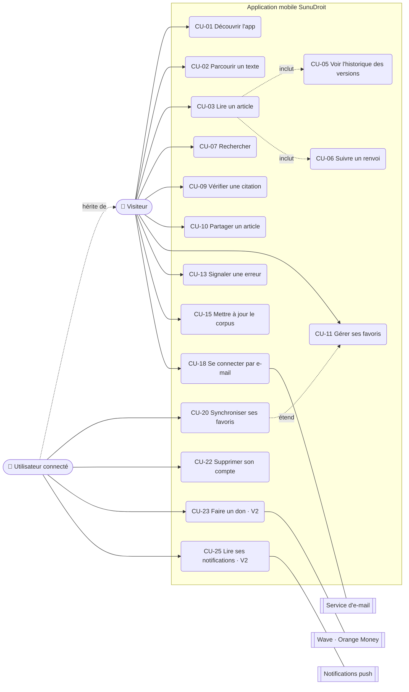
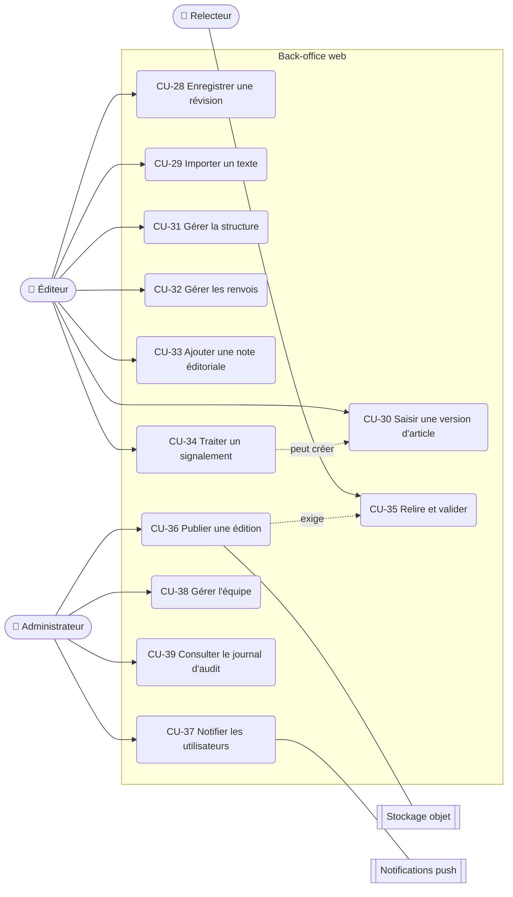

# 02 · Acteurs et cas d'utilisation

## Acteurs

### Humains

| Acteur | Description | Où | Authentification |
|---|---|---|---|
| **Visiteur** | Toute personne qui utilise l'app sans compte. Peut tout lire, chercher, vérifier, partager, garder des favoris sur son téléphone et signaler une erreur. | App mobile | Aucune |
| **Utilisateur connecté** | Visiteur qui a un compte (e-mail vérifié par code). Hérite de tout ce que fait le visiteur. | App mobile | E-mail + code à 6 chiffres, jetons JWT |
| **Éditeur** | Membre de l'équipe qui saisit les textes, les révisions, les renvois et traite les signalements. | Back-office web | E-mail + mot de passe fort + 2e facteur (voir DEC-11) |
| **Relecteur** | Membre de l'équipe, idéalement juriste, qui valide le travail d'un éditeur. Ne peut pas valider sa propre saisie. | Back-office web | Idem |
| **Administrateur** | Publie les éditions du corpus, envoie les notifications, gère les comptes de l'équipe. Au départ : Mamadou. | Back-office web | Idem |

Un même membre de l'équipe peut cumuler plusieurs rôles, **sauf** valider sa propre saisie (RG-21).

### Systèmes externes

| Système | Rôle | Version |
|---|---|---|
| **Service d'e-mail** (Brevo ou équivalent) | Envoie les codes de connexion et les reçus | V1 |
| **Service de notifications push** (Expo Push, qui relaie vers Apple APNs et Google FCM) | Prévient les téléphones qu'une édition ou un reçu est disponible | V1 (envoi d'édition), V2 (boîte de notifications) |
| **Stockage objet** (compatible S3) | Héberge les fichiers des éditions du corpus | V1 |
| **Wave**, **Orange Money** | Encaissent les dons et confirment les paiements | V2 |
| **Journal officiel** (consulté par l'équipe) | Source juridique de référence ; aucune intégration automatique | V1 |

## Diagramme : côté application mobile

## Diagramme : côté back-office

## Liste des cas d'utilisation

Légende des colonnes : **Écrans** = numéros de la maquette ; **SC** = scénario détaillé dans [04](04-scenarios.md).

### Lecture et recherche (visiteur)

| CU | Nom | Acteur | Écrans | Version | SC |
|---|---|---|---|---|---|
| CU-01 | Découvrir l'app (ouverture animée, bienvenue, passer sans compte) | Visiteur | E01, E02 | V1 | SC-01 |
| CU-02 | Parcourir un texte par sa table des matières | Visiteur | E06, E07 | V1 | SC-03 |
| CU-03 | Lire un article (alinéas numérotés, statut, date de version) | Visiteur | E10, E32 | V1 | SC-03 |
| CU-04 | Ajuster la taille du texte des articles | Visiteur | E10, E26 | V1 | SC-03 |
| CU-05 | Consulter l'historique des versions d'un article | Visiteur | E11 | V1 | SC-04 |
| CU-06 | Suivre un renvoi vers une loi organique (ou une décision en V2) | Visiteur | E10, E12 | V1 | SC-05 |
| CU-07 | Rechercher un article, un mot-clé, un thème (accès direct « art 92 », correction des fautes) | Visiteur | E06, E08, E33 | V1 | SC-06 |
| CU-08 | Filtrer les résultats (type de texte, version, titre) | Visiteur | E09 | V1 | SC-06 |
| CU-09 | Vérifier une citation entendue | Visiteur | E06, E13 | V1 | SC-07 |
| CU-10 | Partager un article en image sourcée | Visiteur | E10, E14 | V1 | SC-08 |
| CU-11 | Ajouter, retirer et consulter ses favoris | Visiteur | E10, E15 | V1 | SC-09 |
| CU-12 | Consulter et effacer son historique de lecture et de vérification | Visiteur | E16 | V1 (local) | SC-09 |
| CU-13 | Signaler une erreur sur un article | Visiteur | E10 + écran à concevoir | V1 | SC-12 |
| CU-14 | Régler le thème, la taille du texte, les statistiques anonymes | Visiteur | E26, E29 à E31 | V1 | |
| CU-15 | Recevoir et installer une nouvelle édition du corpus | Visiteur | E26, E34 | V1 | SC-10 |
| CU-16 | Autoriser ou refuser les notifications | Visiteur | E05, E26 | V1 | SC-02 |
| CU-17 | Consulter « À propos et sources » | Visiteur | E28 | V1 | |

### Compte (utilisateur)

| CU | Nom | Acteur | Écrans | Version | SC |
|---|---|---|---|---|---|
| CU-18 | Créer un compte ou se connecter par e-mail et code | Visiteur | E03, E04 | V1 | SC-02 |
| CU-19 | Renseigner ou modifier son prénom et son nom | Utilisateur | E04 bis, E21, E22 | V1 | SC-02 |
| CU-20 | Synchroniser ses favoris entre téléphones | Utilisateur | E15 | V1 | SC-09 |
| CU-21 | Se déconnecter | Utilisateur | E24 | V1 | SC-13 |
| CU-22 | Supprimer son compte | Utilisateur | E22, E23 | V1 | SC-13 |
| CU-23 | Faire un don par Wave ou Orange Money | Visiteur ou utilisateur | E17, E18, E19 | V2 | SC-14 |
| CU-24 | Consulter ses dons et télécharger ses reçus | Utilisateur | E20 | V2 | SC-14 |
| CU-25 | Consulter et marquer comme lues ses notifications | Utilisateur | E25 | V2 | SC-10 |
| CU-26 | Synchroniser son historique | Utilisateur | E16 | V2 | |

### Atelier éditorial (back-office)

| CU | Nom | Acteur | Version | SC |
|---|---|---|---|---|
| CU-27 | Se connecter au back-office | Équipe | V1 | |
| CU-28 | Enregistrer une révision dans le registre (numéro, date, JORS, statut) | Éditeur | V1 | SC-11 |
| CU-29 | Importer un texte en brouillons (base Conseil constitutionnel, loi organique) | Éditeur | V1 | SC-11 |
| CU-30 | Saisir une nouvelle version d'un article (effet d'une révision ou correction) | Éditeur | V1 | SC-11 |
| CU-31 | Gérer la structure d'un texte (divisions, intitulés versionnés, ordre) | Éditeur | V1 | |
| CU-32 | Créer et relier les renvois entre articles et textes | Éditeur | V1 | |
| CU-33 | Ajouter une note éditoriale sur une version | Éditeur | V1 | |
| CU-34 | Traiter un signalement (accepter, refuser, doublon) | Éditeur | V1 | SC-12 |
| CU-35 | Relire et valider (ou renvoyer) une saisie | Relecteur | V1 | SC-11 |
| CU-36 | Publier une édition du corpus | Administrateur | V1 | SC-11 |
| CU-37 | Envoyer une notification de mise à jour | Administrateur | V1 | SC-10 |
| CU-38 | Inviter, désactiver un membre, attribuer les rôles | Administrateur | V1 | |
| CU-39 | Consulter le journal d'audit (qui a fait quoi, quand) | Administrateur | V1 | |

### Tâches automatiques (système)

| CU | Nom | Fréquence | Version |
|---|---|---|---|
| CU-40 | Purger les codes expirés, les sessions révoquées et les comptes supprimés depuis plus de 30 jours | Quotidienne | V1 |
| CU-41 | Confirmer ou expirer les dons en attente (réception des notifications de paiement, relance de statut) | À chaque notification du prestataire + toutes les 5 minutes | V2 |
| CU-42 | Générer le fichier d'une édition et sa somme de contrôle | À chaque publication | V1 |
