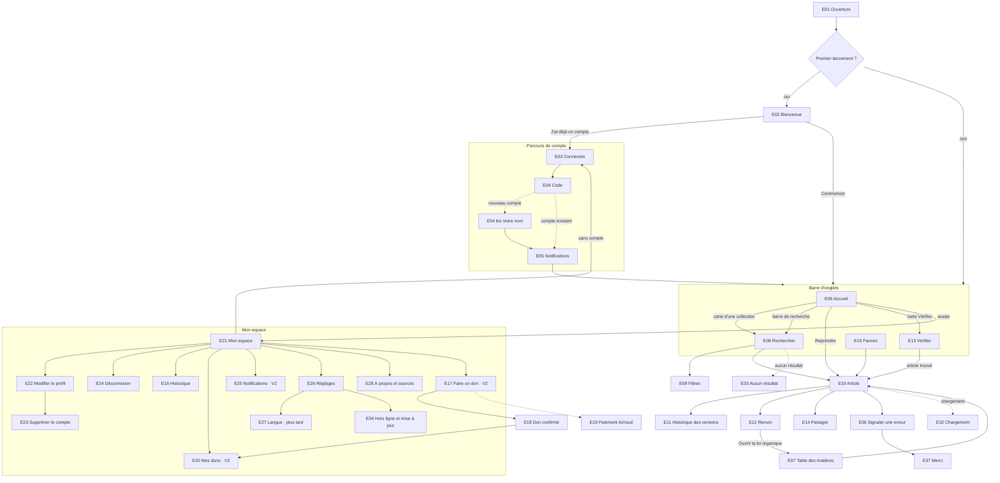

# 03 · Écrans et navigation

Source : fichier Figma « SunuDroit · Maquette app », page **Écrans**, 7 sections, 35 écrans.
Les écrans marqués **V4 (app)** dans Figma correspondent au code actuel ; les autres utilisent encore l'ancienne charte.

## Inventaire des écrans

**État app** : ✅ fait · 🟡 partiel · ⬜ à faire · 🆕 écran à ajouter à la maquette.

### Section 01 · Ouverture et compte

| Écran | Rôle | Contenu clé (maquette) | État app | Version | CU |
|---|---|---|---|---|---|
| E01 Écran d'ouverture | Transition animée au lancement | Logo, « SunuDroit », slogan, barre tricolore, « Corpus vérifié le … · hors ligne » | ✅ (sans la date du corpus) | V1 | CU-01 |
| E02 Bienvenue | Premier lancement uniquement | Orbite de repères (ART.27, LO, 92…), promesse, « Commencer », « J'ai déjà un compte » ; points de pagination (carrousel ?) | ✅ (sans carrousel) | V1 | CU-01 |
| E03 Connexion | Saisie de l'identifiant | Avantages du compte, champ, « Recevoir un code », conditions (Google et Apple retirés, DEC-17) | ✅ e-mail | V1 | CU-18 |
| E04 Code | Saisie du code à 6 chiffres | 6 cases, pavé, « Renvoyer dans 00:42 », « Modifier » | ✅ | V1 | CU-18 |
| E04 bis Votre nom 🆕 | Nouveau compte ou modification | Prénom (obligatoire), nom (facultatif) | ✅ (absent de Figma) | V1 | CU-19 |
| E05 Notifications | Pré-autorisation avant la demande système | Illustration, « Activer », « Plus tard » | ✅ | V1 | CU-16 |

### Section 02 · Consulter le droit

| Écran | Rôle | Contenu clé | État app | Version | CU |
|---|---|---|---|---|---|
| E06 Accueil | Point d'entrée | **V4** : salutation, recherche, Parcourir (carte Constitution + tuiles), Reprendre, Vérifier | ✅ V4 | V1 | CU-02, 07, 09 |
| E07 Table des matières | Plan d'un texte | Préambule, titres, grille des numéros d'articles, statut « en vigueur » | ⬜ | V1 | CU-02 |
| E08 Recherche | Résultats | Correction (« corrigé en … »), meilleur résultat, nombre de liens, résultats de plusieurs textes | 🟡 (pas de « meilleur résultat », pas de liens) | V1 | CU-07 |
| E09 Filtres | Feuille de filtres | Type de texte, version (en vigueur / toutes), titre de la Constitution, « Afficher N résultats » | 🟡 (filtre par type seulement) | V1 | CU-08 |
| E10 Article | Lecture | Fil d'Ariane, statut, « depuis le … · historique », alinéas numérotés, renvoi en ligne, textes liés (précisé par, cité par), taille du texte, partager, favori | ⬜ | V1 | CU-03, 04, 06, 10, 11, 13 |
| E11 Historique des versions | Versions d'un article | Version en vigueur + anciennes, période, révision source, texte | ⬜ | V1 | CU-05 |
| E12 Renvoi | Feuille vers la loi organique | Intitulé, « précise l'article 92 », sections pertinentes, « Ouvrir la loi organique » | ⬜ | V1 | CU-06 |

### Section 03 · Vérifier, partager, retrouver

| Écran | Rôle | Contenu clé | État app | Version | CU |
|---|---|---|---|---|---|
| E13 Vérifier une citation | Comparaison locale | « Analyse locale · hors ligne », verdict (inexact / conforme), « ce qui a été dit » / « ce que dit le texte », mention de l'ancienne version | 🟡 (logique faite, écran vide) | V1 | CU-09 |
| E14 Partager | Image 4:5 avec source | Article, statut, version, « Source : Journal officiel · vérifié avec SunuDroit », choix de couleur | ⬜ | V1 | CU-10 |
| E15 Favoris | Liste hors ligne | « N textes · disponibles hors ligne », filtres (tout, articles, lois organiques), articles **et textes entiers** | 🟡 (état vide) | V1 | CU-11, 20 |
| E16 Historique | Lectures et vérifications | Groupé par jour, filtres, verdict des vérifications, « Effacer l'historique » | ⬜ | V1 local | CU-12 |

### Section 04 · Soutenir l'app

| Écran | Rôle | Contenu clé | État app | Version | CU |
|---|---|---|---|---|---|
| E17 Faire un don | Montant et moyen | Montant libre + 500 / 1 000 / 2 000 / 5 000 FCFA, Wave (ouvre l'app Wave), Orange Money (code OM), mention de sécurité | ⬜ | V2 | CU-23 |
| E18 Don confirmé | Remerciement | « Jërëjëf ! », date, moyen, accès aux reçus | ⬜ | V2 | CU-23 |
| E19 Paiement échoué | Échec sans débit | Moyen, montant, « non débité », référence (SD-2611-8F3K), statut (expiré), réessayer ou changer de moyen | ⬜ | V2 | CU-23 |
| E20 Mes dons et reçus | Historique des dons | Total depuis la première date, liste avec moyen et date, reçu par don | ⬜ | V2 | CU-24 |

### Section 05 · Mon espace et réglages

| Écran | Rôle | Contenu clé | État app | Version | CU |
|---|---|---|---|---|---|
| E21 Mon espace | Tableau de bord du compte | Identité, compteurs (favoris, vérifications, dons), accès favoris, historique, dons, réglages, notifications, à propos, soutenir, déconnexion | 🟡 (identité, thème, nom, notifications, déconnexion) | V1 | CU-19, 21 |
| E22 Modifier le profil | Identité | Photo, prénom et nom, e-mail, ~~téléphone~~, « Supprimer mon compte » | 🟡 (via E04 bis) | V1 | CU-19, 22 |
| E23 Supprimer le compte | Confirmation forte | Ce qui sera supprimé (avec compteurs), conseil sur les reçus, saisie de « SUPPRIMER » | ⬜ | V1 | CU-22 |
| E24 Déconnexion | Confirmation | Feuille « Se déconnecter ? » | ✅ (alerte système) | V1 | CU-21 |
| E25 Notifications | Boîte de réception | Nouvelles / anciennes, types (corpus mis à jour, favori modifié, reçu, nouveauté), « Tout lire », « Gérer » | ⬜ | V2 | CU-25 |
| E26 Réglages | Préférences | Thème, taille du texte (aperçu), langue, notifications de révisions, textes hors ligne « à jour », statistiques anonymes, confidentialité, version + date du corpus | 🟡 (thème dans Mon espace) | V1 | CU-14, 15, 16 |
| E27 Langue | Choix de langue | Français ; wolof et anglais « bientôt » ; les textes de loi restent en français | ⬜ | Plus tard | |
| E28 À propos et sources | Transparence | Version, date du corpus, mission, avertissement « seule la publication au Journal officiel fait foi », sources, mentions légales, confidentialité, contact | ⬜ | V1 | CU-17 |

### Sections 06 et 07 · Thème sombre et états système

| Écran | Rôle | État app | Version |
|---|---|---|---|
| E29 à E31 Accueil, Mon espace, Réglages en sombre | Thème sombre | ✅ (tout l'app suit le thème) | V1 |
| E32 Chargement | Squelette pendant l'ouverture d'un article | ⬜ | V1 |
| E33 Aucun résultat | Suggestions de recherche, renvoi vers Vérifier | 🟡 (sans suggestions) | V1 |
| E34 Hors ligne et mise à jour | Édition disponible, progression, « ce qui change », reprise | ⬜ | V1 |
| E35 Erreur serveur | Compte et dons indisponibles, textes lisibles | ⬜ | V1 |

### Écrans à ajouter à la maquette 🆕

| Écran | Pourquoi | Version |
|---|---|---|
| E04 bis Votre nom | Nouveau parcours de compte (déjà codé) | V1 |
| E36 Signaler une erreur | Contributions ouvertes à tous (DEC-08) | V1 |
| E37 Merci pour votre signalement | Confirmation, numéro de suivi | V1 |
| E38 Lecture d'un texte entier | La maquette montre la table des matières (E07) et l'article (E10), mais pas le défilement continu d'un texte | V1 |
| E39 Mise à jour obligatoire de l'app | Si une édition exige une version plus récente de l'app (RG-27) | V1 |

## Carte de navigation

Les numéros renvoient aux écrans ci-dessus. Les flèches en pointillés sont conditionnelles.

**Règles de navigation** (déjà en place dans l'app, voir CLAUDE.md) :

- Les routes sont **protégées** selon l'état : Bienvenue n'existe qu'au premier lancement ; les onglets et Mon espace
  après ; Votre nom seulement avec une session. Chaque garde a un `redirectTo` explicite.
- Après une connexion réussie, Connexion et Code sont **retirés de l'historique** : « Retour » ne ramène jamais
  vers un formulaire déjà validé.
- Un lien direct sans historique (notification, lien partagé) ramène à l'accueil quand on touche « Retour ».

## Liens profonds (deep links)

| Lien | Ouvre | Usage |
|---|---|---|
| `sunudroit://article/{articleId}` | E10 Article | Notification « un de vos favoris a changé », partage |
| `sunudroit://article/{articleId}/versions` | E11 | Lien depuis une notification de révision |
| `sunudroit://texte/{texteId}` | E07 | Partage d'un texte entier |
| `sunudroit://recherche?q=…&type=…` | E08 | Raccourcis |
| `sunudroit://mise-a-jour` | E34 | Notification « le corpus a été mis à jour » |
| `sunudroit://dons/{donationId}` | E18 ou E19 | Retour depuis Wave ou Orange Money (V2) |

Les liens partagés publiquement (`https://sunudroit.sn/a/{articleId}`) ouvrent l'app si elle est installée,
sinon une page web légère avec le texte de l'article et un lien vers les stores (DEC-14).

## Écarts entre la maquette et les décisions prises

| Écart | Écrans | Décision | Action sur la maquette |
|---|---|---|---|
| EC-01 Connexion par numéro de téléphone et SMS | E03, E04, E21, E22, E23, E24 | Remplacée par e-mail + code (DEC-05) | Mettre à jour les textes (« reconnectez-vous avec votre e-mail »), retirer le champ téléphone de E22 |
| EC-02 Ancien accueil (pile de cartes, puces, cloche, « Tout voir ») | E06, E29 | Nouvel accueil V4 (DEC-04) | Remplacer E06 et E29 par la V4 (E06 V4 existe, E29 sombre à refaire) |
| EC-03 Polices Bricolage, Instrument, JetBrains | Toutes sauf V4 | Inter seule (DEC-03) | Passer les styles de texte du fichier Figma en Inter |
| EC-04 Animations à rebond (non visible en maquette) | | Mouvement doux sans rebond (DEC-03) | Aucune |
| EC-05 Photo de profil | E22 | Non prévue en V1 (Q-06) | Masquer « Changer la photo » ou le marquer « plus tard » |
| EC-06 « E-mail facultatif, pour les reçus » | E22 | L'e-mail est l'identifiant, obligatoire | Corriger le libellé ; changer d'e-mail = nouvelle vérification par code (RG-44) |
| EC-07 Thème dans Mon espace (ligne « Thème clair ») | E21, E26 | Le thème est réglé dans Réglages (E26) ; l'app le montre aujourd'hui dans Mon espace | Garder E26 comme référence ; déplacer le réglage dans l'app quand E26 sera codé |
| EC-08 Cloche sur l'accueil | E06 ancien | Retirée tant que la boîte de notifications (E25) n'existe pas | La remettre en V2 avec E25 |
| EC-09 Points de pagination sur Bienvenue | E02 | Un seul écran de bienvenue | Retirer les points (fait dans la V4) |
| EC-10 Décisions du Conseil dans les résultats et les renvois | E06, E08, E10 | Décisions en V2 | Garder dans la maquette, masquer en V1 |
| EC-11 Écran de signalement absent | E10 | Contributions ouvertes (DEC-08) | Dessiner E36 et E37 |
| EC-12 Boutons « Avec Google » et « Avec Apple » | E03 | E-mail seul en V1 (DEC-17) | Retirer les boutons et le séparateur « OU » |
