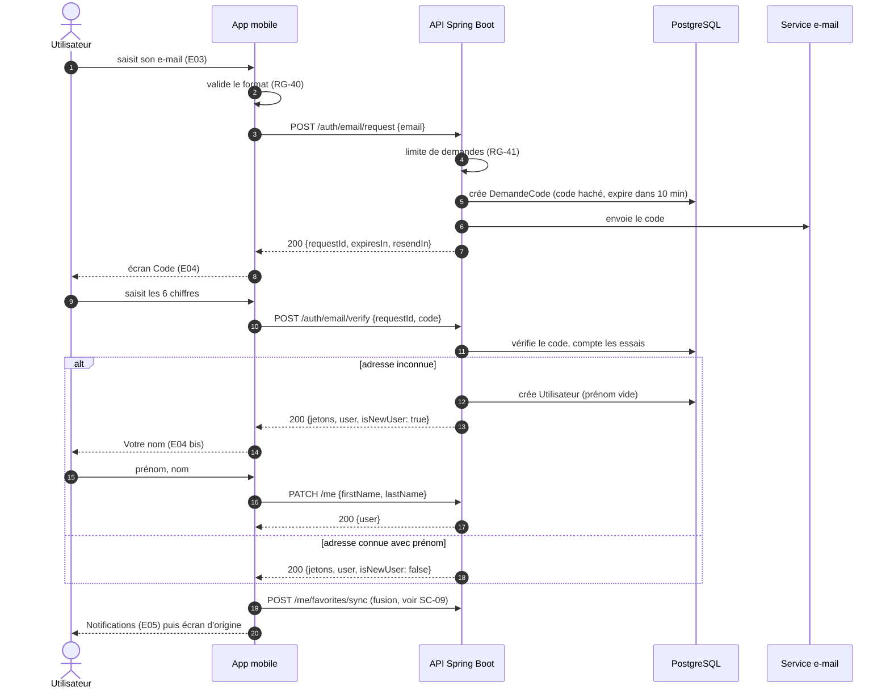
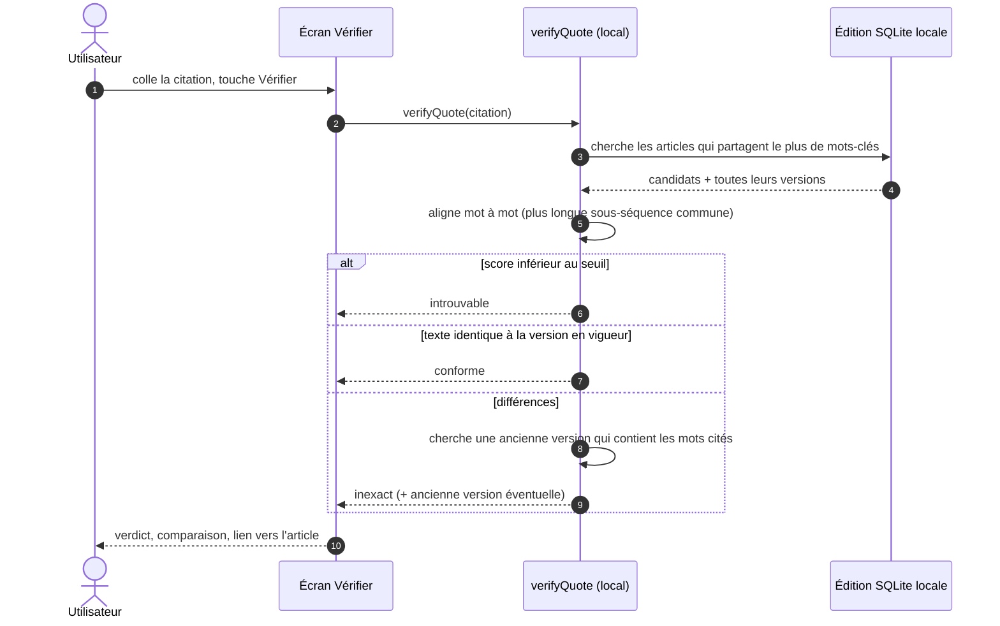
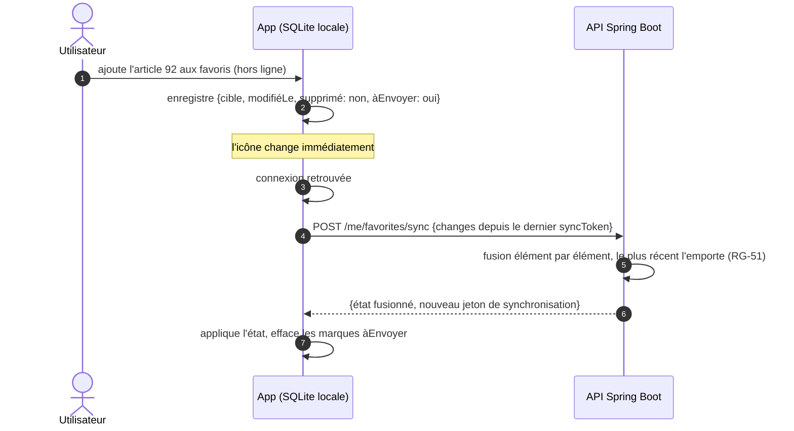
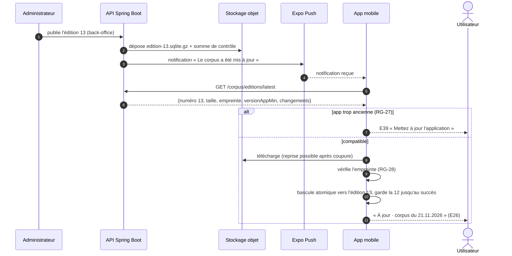
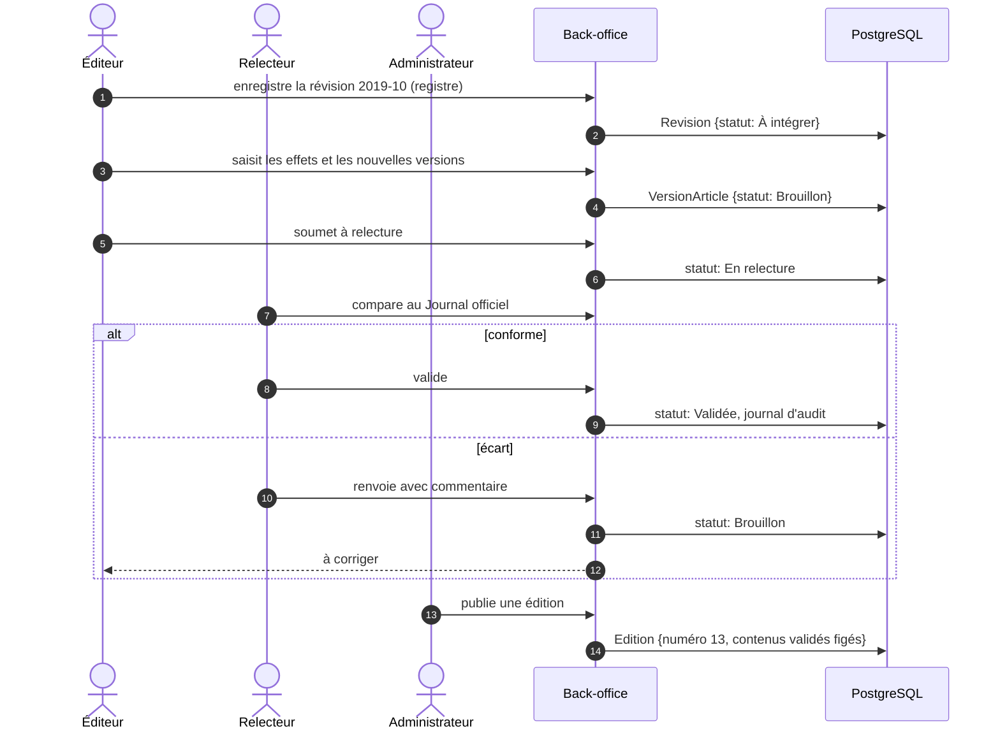
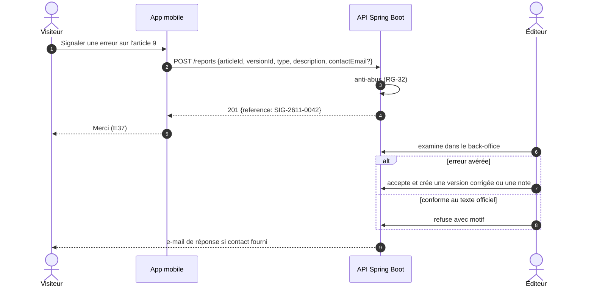
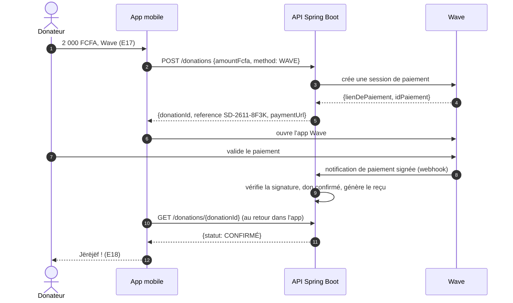

# 04 · Scénarios détaillés

Chaque scénario décrit le **parcours nominal**, ses **variantes** et ses **cas d'erreur**.
Les numéros d'écrans (E..), de cas d'utilisation (CU-..) et de règles (RG-..) renvoient aux autres documents.

---

## SC-01 · Premier lancement

**CU** : CU-01, CU-16 · **Écrans** : E01, E02, E06 · **Version** : V1

**Préconditions** : app installée avec l'édition du corpus embarquée (RG-29).

1. L'utilisateur ouvre l'app. Le splash natif vert s'affiche, puis l'écran d'ouverture animé (E01) avec la date du corpus.
2. L'app lit l'état local : premier lancement, aucune session.
3. Bienvenue (E02) s'affiche.
4. L'utilisateur touche « Commencer » : l'indicateur « bienvenue vue » est enregistré, l'accueil (E06) s'affiche.

**Variantes**
- 4a. « J'ai déjà un compte » : SC-02 commence à E03 ; « Passer » sur E03 mène à l'accueil.
- 1a. Pas de réseau : aucun effet, tout fonctionne (le corpus est sur le téléphone).
- 1b. Une édition plus récente que celle embarquée existe : vérification en arrière-plan, voir SC-10.

---

## SC-02 · Créer un compte ou se connecter

**CU** : CU-18, CU-19, CU-16 · **Écrans** : E03, E04, E04 bis, E05 · **Version** : V1
**Règles** : RG-40 à RG-43

**Parcours nominal (nouveau compte)**

1. L'utilisateur saisit son e-mail (E03) et touche « Recevoir un code par e-mail ».
2. L'app valide le format localement, puis appelle `POST /auth/email/request`.
3. Le serveur génère un code à 6 chiffres, le stocke haché, l'envoie par e-mail, répond `requestId`, `expiresIn`, `resendIn`.
4. E04 affiche « Envoyé par e-mail à a•••@gmail.com » et le compte à rebours.
5. L'utilisateur saisit le code ; à 6 chiffres, l'app appelle `POST /auth/email/verify`.
6. Le serveur crée le compte, répond la session et `isNewUser: true`.
7. L'app enregistre la session de façon chiffrée, puis ouvre « Votre nom » (E04 bis).
8. L'utilisateur saisit son prénom (et son nom) ; `PATCH /me`.
9. E05 propose les notifications ; l'utilisateur choisit ; retour à l'écran d'origine, sans retour possible vers E03 et E04.
10. Les favoris locaux sont fusionnés avec le compte (SC-09, étape de fusion).

**Variantes**
- 6a. **Compte existant** : `isNewUser: false`, l'écran du nom est sauté.
- 6b. **Compte existant sans prénom** (parcours interrompu à l'étape 8 la fois précédente) : l'app traite comme un nouveau compte.
- 4a. « Modifier » sur E04 : retour à E03 avec l'adresse saisie.
- 4b. « Renvoyer un code » après le compte à rebours : nouvelle demande, le délai repart.

**Erreurs**

| Cas | Réponse serveur | Affichage |
|---|---|---|
| Format d'e-mail invalide | (aucun appel) | Contour rouge, « Cette adresse ne semble pas valide » |
| Trop de demandes | 429 `RATE_LIMITED` | « Trop de demandes. Patientez une minute. » |
| Code faux | 400 `INVALID_CODE` | Secousse, cases vidées, message |
| Code expiré | 400 `CODE_EXPIRED` | Message + « Renvoyer un code » |
| 5 essais dépassés | 400 `TOO_MANY_ATTEMPTS` | « Demandez un nouveau code » |
| Pas de réseau | (échec d'appel) | « Pas de connexion. Les textes restent lisibles hors ligne. » |
| Serveur indisponible | 503 | E35 « Le compte est momentanément indisponible » |
| E-mail non reçu | | Conseil : vérifier les indésirables ; renvoi possible |

---

## SC-03 · Lire un article

**CU** : CU-02, CU-03, CU-04 · **Écrans** : E06, E07, E10, E32 · **Version** : V1

1. L'utilisateur arrive sur un article par l'une des entrées : table des matières (E07), résultat de recherche (E08),
   « Reprendre » (E06), favori (E15), vérification (E13), lien profond.
2. L'app lit l'article et sa version en vigueur **dans l'édition locale** (aucun appel réseau).
3. E10 affiche : fil d'Ariane (texte · titre), numéro, statut (« en vigueur »), « depuis le 05.04.2016 · historique »,
   alinéas numérotés, renvois soulignés, notes éditoriales, textes liés.
4. L'app enregistre une entrée « lecture » dans l'historique local (E16) et met à jour « Reprendre ».

**Variantes**
- 2a. Lecture lente (téléphone ancien) : squelette E32 au-delà de 300 ms.
- 3a. **Article abrogé** : statut « abrogé depuis le … », texte de la dernière version, mention de la révision.
- 3b. **Note éditoriale** : encadré sous l'alinéa concerné (« Rédaction officielle malencontreuse, voir loi 2008-33 »).
- 3c. Taille du texte : boutons « A » (E10) ou réglage (E26), mémorisés sur le téléphone (RG-47).
- 3d. L'utilisateur ajoute aux favoris (SC-09), partage (SC-08), signale une erreur (SC-12).

---

## SC-04 · Consulter l'historique des versions

**CU** : CU-05 · **Écrans** : E10, E11 · **Version** : V1

1. Sur E10, l'utilisateur touche « Historique ».
2. E11 liste les versions, de la plus récente à la plus ancienne : période (« 21.10.2008 → 05.04.2016 »), statut
   (« en vigueur » ou « ancienne »), révision source (« Loi constitutionnelle n° 2008-66 »), texte complet.
3. Option : affichage des différences mot à mot entre deux versions (calculé sur le téléphone, RG-06).

**Variantes**
- 2a. Une seule version connue : « Aucune modification connue depuis le … » (et rappel de la date du corpus).
- 2b. Version issue d'une révision **censurée** : n'apparaît pas (la révision n'a pas d'effet, RG-09) ; une note peut l'expliquer.

---

## SC-05 · Suivre un renvoi

**CU** : CU-06 · **Écrans** : E10, E12, E07 · **Version** : V1

1. Sur E10, l'utilisateur touche un renvoi en ligne (« Une loi organique ↗ ») ou une carte « Précisé par ».
2. La feuille E12 s'ouvre : intitulé de la loi organique, statut, « précise l'article 92 », sections pertinentes.
3. L'utilisateur touche une section : ouverture du texte cible à cette division (E07 ou E38).

**Variantes**
- 2a. Cible absente de l'édition (texte prévu en V2, comme une décision) : la carte est masquée en V1 (EC-10).
- 2b. Cible abrogée : badge « abrogé », lecture possible.

---

## SC-06 · Rechercher

**CU** : CU-07, CU-08 · **Écrans** : E06, E08, E09, E33 · **Version** : V1

1. L'utilisateur touche la recherche (E06) : E08 s'ouvre, clavier prêt.
2. À chaque frappe, recherche **locale** dans l'édition (index plein texte du téléphone).
3. Résultats : « meilleur résultat », puis articles et textes ; extrait centré sur les mots trouvés ; nombre de renvois.

**Variantes**
- 2a. **Accès direct** : « 92 », « art 92 », « article premier » ouvrent l'article en premier résultat.
- 2b. **Faute de frappe** : « conseil constitutionel » donne « 3 résultats · corrigé en “conseil constitutionnel” ».
- 2c. **Filtres** (E09) : type de texte, version (en vigueur / toutes, pour chercher dans les anciennes versions),
  titre de la Constitution ; « Afficher N résultats » ; « Réinitialiser ».
- 2d. Arrivée depuis une carte de l'accueil : filtre déjà posé (puce retirable).
- 3a. **Aucun résultat** (E33) : rappel du périmètre (« les codes arriveront plus tard »), suggestions, lien vers Vérifier.

---

## SC-07 · Vérifier une citation

**CU** : CU-09 · **Écrans** : E13, E10 · **Version** : V1 · **Logique existante** : `features/verify/verifyQuote.ts`

1. L'utilisateur colle ou tape une phrase entendue et touche « Vérifier ».
2. L'analyse est **locale** (« analyse locale · hors ligne ») : article le plus proche, alignement mot à mot.
3. Verdict affiché avec « ce qui a été dit » et « ce que dit le texte en vigueur », mots divergents surlignés.
4. L'entrée est enregistrée dans l'historique local (verdict, article ; la citation reste sur le téléphone, RG-55).

| Verdict | Affichage |
|---|---|
| **Conforme** | Badge vert, texte officiel, lien vers l'article |
| **Inexact** | Badge corail, mots divergents surlignés des deux côtés |
| **Inexact, ancienne version** | En plus : « “Sept ans” correspond à la rédaction issue de la loi 2008-66, remplacée en 2016 » |
| **Introuvable** | « Aucun article ne correspond » + conseils (citation trop courte, hors périmètre) |

---

## SC-08 · Partager un article

**CU** : CU-10 · **Écrans** : E10, E14 · **Version** : V1

1. Sur E10, « Partager l'article ».
2. E14 génère une **image 4:5** : « Constitution du Sénégal », statut, numéro, texte de la version en vigueur,
   « Version : loi const. n° 2016-10 du 05.04.2016 · Source : Journal officiel · Vérifié avec SunuDroit », couleur au choix.
3. Feuille de partage du système (WhatsApp, etc.), avec en texte le lien public de l'article (DEC-14).

**Variantes**
- 2a. Article trop long pour une image : texte tronqué avec « … suite sur SunuDroit » et lien.
- 2b. Partage depuis l'historique des versions : l'image indique clairement « ancienne version » et sa période.

---

## SC-09 · Favoris et historique

**CU** : CU-11, CU-12, CU-20 · **Écrans** : E10, E15, E16 · **Version** : V1 (favoris synchronisés), historique local

**Sans compte** : favoris et historique vivent seulement sur le téléphone.

**Avec compte** : chaque ajout ou retrait est enregistré localement **tout de suite**, puis envoyé au serveur dès que possible.

**Fusion à la première connexion** : union des favoris locaux et des favoris du compte, sans doublon (RG-50, RG-51).

**Variantes**
- Favori d'un **texte entier** (une loi organique) : même mécanisme, cible de type texte.
- Favori d'un article **abrogé** dans une nouvelle édition : reste dans la liste avec la mention « abrogé » (RG-52).
- Historique (E16) : lectures et vérifications groupées par jour, filtres, « Effacer l'historique » ; limité (RG-53).

---

## SC-10 · Recevoir une nouvelle édition du corpus

**CU** : CU-15, CU-37, CU-25 · **Écrans** : E01, E25, E26, E34 · **Version** : V1

**Variantes**
- **Hors ligne** (E34) : « Mise à jour disponible · 3 textes · 1,2 Mo · en attente de connexion · 64 % » ;
  « Ce qui change » (rédaction vérifiée art. 92, plan ajouté LO 2016-23, nouveau texte) ; reprise automatique.
- **Sans notification** (refusées) : la vérification se fait à l'ouverture de l'app et une fois par jour au plus.
- **Empreinte invalide** : fichier rejeté, nouvelle tentative plus tard, l'édition actuelle reste active.
- **Favori modifié** par la nouvelle édition : notification ciblée « Un de vos favoris a changé » (V2, E25).

---

## SC-11 · Intégrer une révision (back-office)

**CU** : CU-28 à CU-36 · **Acteurs** : Éditeur, Relecteur, Administrateur · **Version** : V1

Exemple : intégrer la loi constitutionnelle n° 2019-10 du 14 mai 2019.

1. L'éditeur enregistre la révision dans le **registre** : numéro, date, objet, référence JORS (numéro, date, page),
   statut juridique (promulguée), statut d'intégration « à intégrer ».
2. Il saisit chaque **effet** : « remplace l'article 49 », « abroge l'article 53 », « modifie l'intitulé du titre IV »…
3. Pour chaque article touché, il crée une **nouvelle version en brouillon** : texte complet, date d'entrée en vigueur,
   révision source. La version précédente recevra automatiquement sa date de fin.
4. Il ajoute les notes éditoriales éventuelles et met à jour les renvois.
5. Il soumet l'ensemble à relecture.
6. Le relecteur compare au Journal officiel, valide ou renvoie avec un commentaire (RG-20, RG-21).
7. Quand tout est validé, la révision passe à « intégrée ».
8. L'administrateur publie une **édition** : le serveur assemble les contenus validés, génère le fichier et le changelog.
9. Notification aux utilisateurs (SC-10).

**Erreurs et garde-fous**
- Chevauchement de périodes entre deux versions : refusé à l'enregistrement (RG-04).
- Révision **censurée** (ex. loi de 2026) : enregistrée avec ce statut, ne peut pas porter de nouvelle version (RG-09).
- Publication avec des brouillons en cours : autorisée, mais seuls les contenus **validés** entrent dans l'édition (RG-22).

---

## SC-12 · Signaler une erreur

**CU** : CU-13, CU-34 · **Écrans** : E10, E36, E37 · **Version** : V1

1. Sur E10, « Signaler une erreur ». E36 : type (texte différent du Journal officiel, faute, renvoi incorrect, autre),
   alinéa concerné (facultatif), description, source (facultatif), e-mail de contact (facultatif sans compte).
2. `POST /reports` ; l'app conserve le signalement si hors ligne et l'envoie plus tard.
3. E37 : « Merci », numéro de suivi.
4. Back-office : l'éditeur l'examine, le rattache à l'article et à la version, puis :
   - **accepté** : création d'une version corrigée (SC-11) ou d'une note éditoriale ;
   - **refusé** : avec motif (ex. « conforme au Journal officiel n° 6926 ») ;
   - **doublon** : rattaché à un signalement existant.
5. Si un contact existe, il reçoit la réponse par e-mail (RG-33).

---

## SC-13 · Se déconnecter, supprimer son compte

**CU** : CU-21, CU-22 · **Écrans** : E21, E22, E23, E24 · **Version** : V1

**Déconnexion** (E24)
1. « Se déconnecter » puis confirmation.
2. La session locale est effacée tout de suite ; l'app demande au serveur de révoquer le jeton (sans bloquer si hors ligne).
3. Les données **du compte** sont retirées du téléphone (favoris synchronisés), les préférences restent (RG-46).

**Suppression** (E23)
1. E23 liste ce qui sera supprimé (favoris, historique synchronisé, identité) et rappelle de télécharger les reçus.
2. L'utilisateur tape « SUPPRIMER » pour activer le bouton.
3. `DELETE /me` : le compte est désactivé immédiatement (connexion impossible, données invisibles), toutes les sessions révoquées.
4. Purge définitive à J+30 (CU-40) ; les reçus de dons sont conservés **sans lien avec la personne** pour les obligations comptables (RG-45).
5. Retour à l'accueil en visiteur.

---

## SC-14 · Faire un don (V2)

**CU** : CU-23, CU-24 · **Écrans** : E17 à E20 · **Règles** : RG-60 à RG-64

**Variantes et erreurs**
- **Orange Money** : confirmation par code OM sur le téléphone, même principe côté serveur.
- **Délai expiré** (15 min, RG-63) : E19 « non débité », référence, statut « expiré », réessayer ou changer de moyen.
- **Annulation dans Wave** : E19 avec statut « annulé ».
- **Notification de paiement perdue** : la tâche CU-41 interroge le prestataire jusqu'à un statut final.
- **Don sans compte** : possible ; le reçu est envoyé à un e-mail saisi au moment du don.
- **Mes dons** (E20) : total, liste, téléchargement du reçu en PDF.
