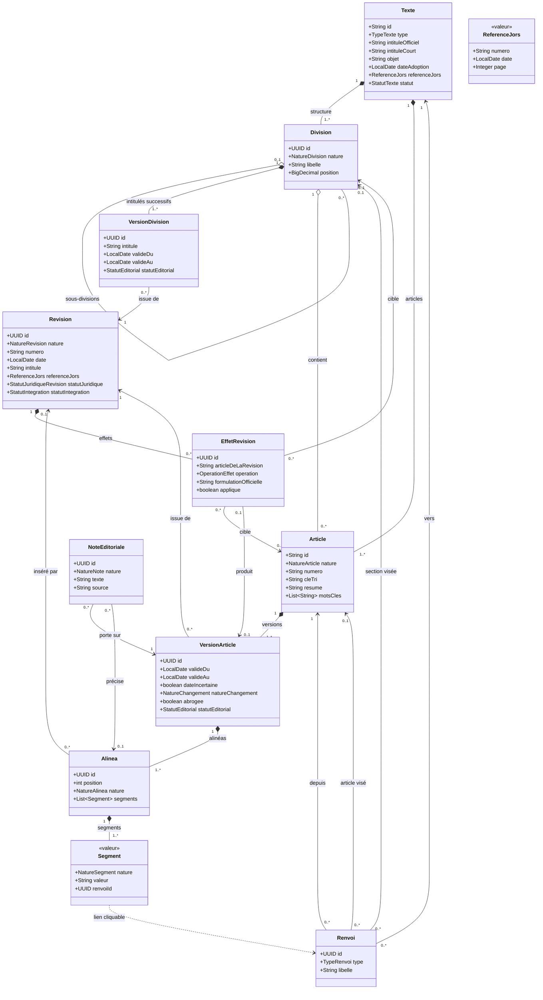
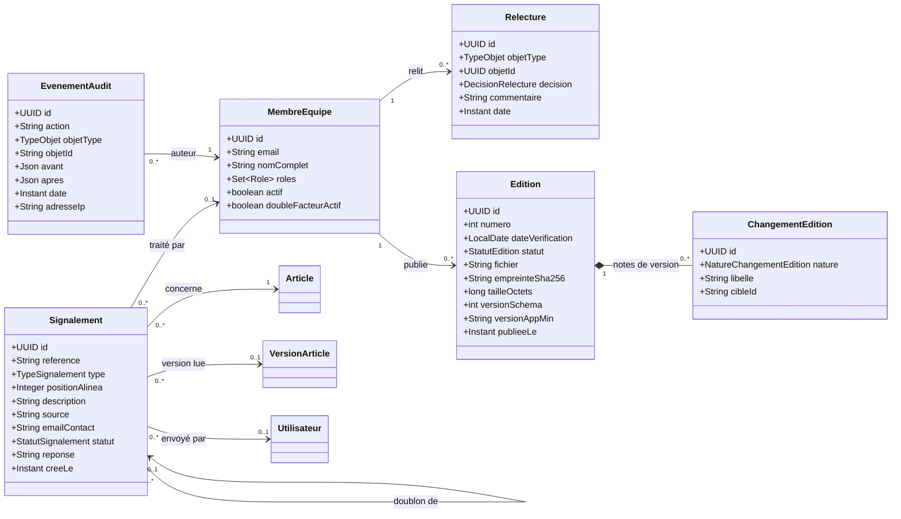
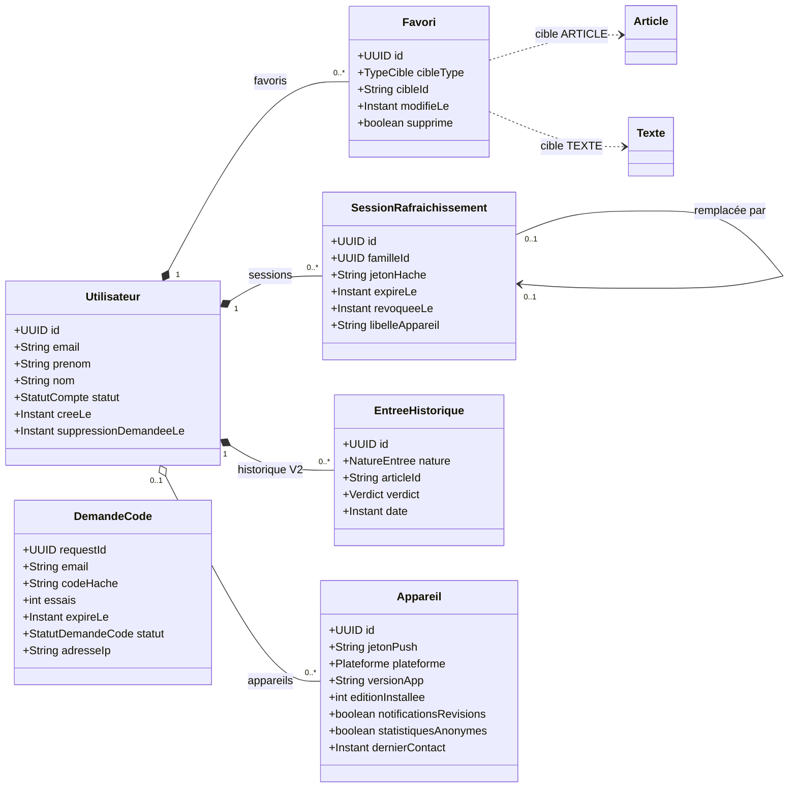
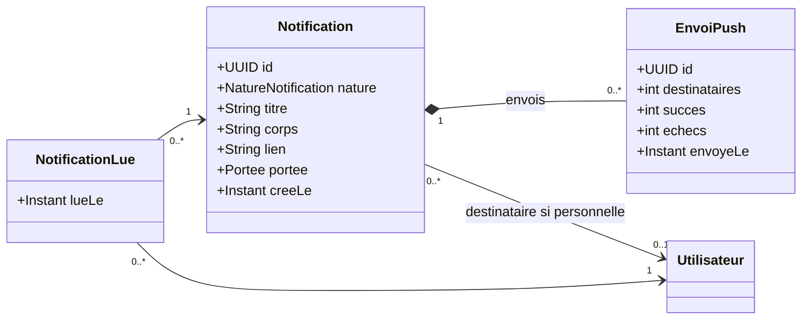
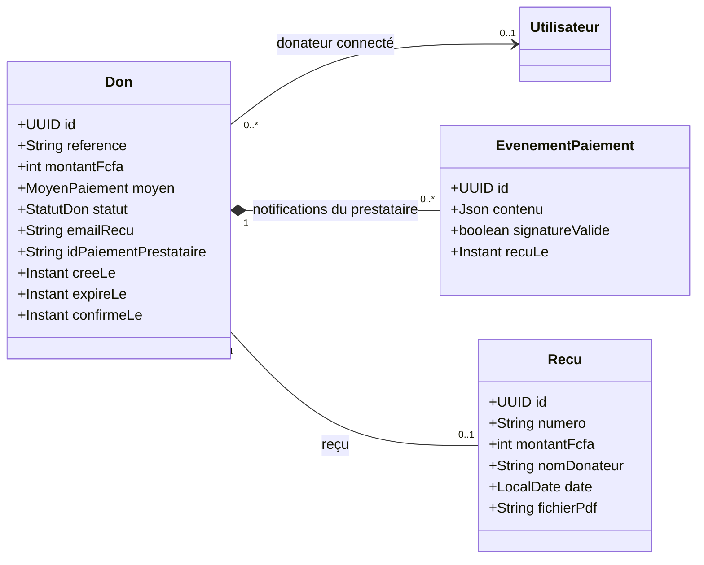

# 05 · Modèle du domaine

Le domaine est découpé en **cinq modules**. Chacun deviendra un paquet Java du backend (voir [08](08-architecture.md)).
Un module ne lit pas directement les tables d'un autre : il passe par son service.

| Module | Rôle | Version |
|---|---|---|
| **corpus** | Le droit lui-même : textes, structure, articles, versions, révisions, renvois, notes | V1 |
| **atelier** | Le travail de l'équipe : relecture, éditions publiées, signalements, audit | V1 |
| **compte** | Utilisateurs, codes de connexion, sessions, favoris, historique, appareils | V1 |
| **notification** | Boîte de notifications et envois push | V1 (push d'édition), V2 (boîte) |
| **don** | Dons, paiements, reçus | V2 |

Ce document décrit les **concepts métier**. Les tables SQL précises sont dans [06](06-modele-donnees.md).

---

## Module corpus

Le droit est un **graphe** de textes reliés, pas une liste de PDF.
Les cas observés dans la Constitution (version annotée du Conseil constitutionnel) ont guidé chaque choix :

| Cas réel | Concept qui le gère |
|---|---|
| Préambule sans numéro, « partie intégrante » | `Division` de nature `PREAMBULE` contenant un `Article` de nature `PREAMBULE` |
| « TITRE VI BIS », « TITRE VII-1 » | `Division.libelle` (texte officiel) + `Division.position` (ordre) |
| Intertitres « MARIAGE ET FAMILLE », « TRAVAIL » | `Division` de nature `INTERTITRE` |
| « Article premier », articles 25-1, 66-1, 87-1 | `Article.numero` (texte officiel) + `Article.cleTri` (ordre) |
| Titre II renommé en 2016 | `VersionDivision` (intitulé versionné) |
| 9 lois de révision citées | `Revision` |
| « remplaçant l'article 4 », « supprimant les mots “et les sénateurs” » | `EffetRevision` avec sa formulation officielle |
| Alinéa inséré par la loi 2008-30 | `Alinea.insereParRevision` |
| « NB : rédaction malencontreuse », « modification annoncée non mise en œuvre » | `NoteEditoriale` |
| Énumérations des articles 6 et 8 | `Alinea` de nature `ELEMENT_LISTE` |
| Loi de 2026 adoptée puis censurée | `Revision.statutJuridique = CENSUREE`, sans effet |

**Points de modélisation importants**

- **Identifiants permanents** : `Texte.id` (`constitution-2001`) et `Article.id` (`const-art-25-1`) sont des chaînes stables,
  écrites une fois, jamais réutilisées. Les favoris, les liens partagés et l'historique pointent vers eux (RG-01).
- **Une version est un instantané complet** de l'article. On ne stocke pas de différences : elles sont calculées à l'affichage (DEC-13).
- **« En vigueur » et « ancienne » ne sont pas stockés** : ils se déduisent des dates (`valideAu` vide = en vigueur à ce jour).
- **L'acte d'origine est une révision comme une autre** : la loi n° 2001-03 du 22 janvier 2001 est une `Revision`
  de nature `ACTE_ORIGINE`. Ainsi toute version a une révision source, sans cas particulier.
- **Une révision censurée ou non appliquée** existe dans le registre mais ne produit aucune version (RG-09).
  Un effet annoncé mais non mis en œuvre (article 84 en 2012) a `applique = false` et une note éditoriale l'explique.
- **Le rattachement d'un article à sa division** suit la structure actuelle. Si une révision déplace un article, on
  versionnera ce rattachement (cas non rencontré à ce jour, noté en Q-12).

### Énumérations du module corpus

| Énumération | Valeurs |
|---|---|
| `TypeTexte` | `CONSTITUTION`, `LOI_ORGANIQUE`, `DECISION` (V2) |
| `StatutTexte` | `EN_VIGUEUR`, `ABROGE`, `CENSURE` |
| `NatureDivision` | `PREAMBULE`, `TITRE`, `CHAPITRE`, `SECTION`, `INTERTITRE` |
| `NatureArticle` | `ARTICLE`, `PREAMBULE` |
| `NatureChangement` | `ORIGINELLE`, `REMPLACEMENT`, `MODIFICATION`, `INSERTION`, `ABROGATION` |
| `NatureAlinea` | `TEXTE`, `ELEMENT_LISTE` |
| `NatureSegment` | `TEXTE`, `RENVOI` |
| `NatureRevision` | `ACTE_ORIGINE`, `LOI_CONSTITUTIONNELLE`, `REFERENDUM`, `LOI_ORGANIQUE` |
| `StatutJuridiqueRevision` | `PROMULGUEE`, `CENSUREE`, `EN_PROJET` |
| `StatutIntegration` | `A_INTEGRER`, `EN_COURS`, `INTEGREE` |
| `OperationEffet` | `REMPLACE_ARTICLE`, `AJOUTE_ARTICLE`, `ABROGE_ARTICLE`, `INSERE_ALINEA`, `MODIFIE_ALINEA`, `SUPPRIME_MOTS`, `REMPLACE_MOTS`, `AJOUTE_DIVISION`, `MODIFIE_INTITULE` |
| `NatureNote` | `ERREUR_MATERIELLE`, `MODIFICATION_NON_APPLIQUEE`, `MOTS_SUBSISTANTS`, `PRECISION` |
| `TypeRenvoi` | `PRECISE_PAR` (un article renvoie à une loi organique), `CITE_PAR` (une décision cite l'article, V2), `RENVOIE_A` (renvoi interne : « article 63 ») |
| `StatutEditorial` | voir le cycle de vie dans [07](07-cycles-de-vie.md) |

---

## Module atelier

| Énumération | Valeurs |
|---|---|
| `Role` | `EDITEUR`, `RELECTEUR`, `ADMIN` |
| `DecisionRelecture` | `VALIDEE`, `RENVOYEE` |
| `TypeObjet` | `VERSION_ARTICLE`, `VERSION_DIVISION`, `RENVOI`, `NOTE`, `REVISION`, `EDITION`, `SIGNALEMENT`, `MEMBRE` |
| `StatutEdition` | `EN_PREPARATION`, `PUBLIEE`, `RETIREE` |
| `NatureChangementEdition` | `NOUVELLE_VERSION`, `REDACTION_VERIFIEE`, `PLAN_AJOUTE`, `NOUVEAU_TEXTE`, `NOTE_AJOUTEE`, `RENVOI_AJOUTE` (libellés visibles sur E34) |
| `TypeSignalement` | `TEXTE_DIFFERENT_JO`, `FAUTE`, `RENVOI_INCORRECT`, `VERSION_MANQUANTE`, `AUTRE` |
| `StatutSignalement` | voir [07](07-cycles-de-vie.md) |

**La relecture concerne toute saisie** : version d'article, intitulé de division, renvoi, note. Le relecteur
ne peut pas être l'auteur de la saisie (RG-21). Chaque action de l'équipe produit un `EvenementAudit` immuable (RG-24).

---

## Module compte

| Énumération | Valeurs |
|---|---|
| `StatutCompte` | `ACTIF`, `SUPPRESSION_DEMANDEE` |
| `StatutDemandeCode` | `EMISE`, `VERIFIEE`, `EXPIREE`, `BLOQUEE` |
| `TypeCible` | `ARTICLE`, `TEXTE` |
| `NatureEntree` | `LECTURE`, `VERIFICATION` |
| `Verdict` | `CONFORME`, `INEXACT`, `INTROUVABLE` |
| `Plateforme` | `IOS`, `ANDROID` |

- **Un compte est identifié par son `id`, jamais par son e-mail** : l'adresse peut changer (RG-44), et des connexions
  Google ou Apple pourront s'ajouter plus tard dans une classe `IdentiteExterne` sans toucher aux comptes existants (DEC-17).
- **Un appareil existe sans compte** : il reçoit les notifications d'édition même pour un visiteur.
  À la connexion, il est rattaché à l'utilisateur ; à la déconnexion, détaché.
- **Les favoris ne sont jamais effacés physiquement pendant la synchronisation** : `supprime = true` avec la date,
  pour que la suppression se propage aux autres téléphones (RG-51).

---

## Module notification

| Énumération | Valeurs |
|---|---|
| `NatureNotification` | `CORPUS_MIS_A_JOUR`, `FAVORI_MODIFIE`, `RECU_DISPONIBLE`, `REPONSE_SIGNALEMENT`, `NOUVEAUTE` (types visibles sur E25) |
| `Portee` | `TOUS` (édition, nouveauté) ou `PERSONNELLE` (reçu, favori modifié, réponse) |

---

## Module don (V2)

| Énumération | Valeurs |
|---|---|
| `MoyenPaiement` | `WAVE`, `ORANGE_MONEY` |
| `StatutDon` | voir [07](07-cycles-de-vie.md) |

Le `Recu` copie le nom et le montant au moment du don : il reste valable même si le compte est supprimé (RG-45, RG-64).

---

## Côté application mobile

L'app ne connaît pas tout le domaine. Elle manipule :

| Donnée | Où | Synchronisée |
|---|---|---|
| Édition du corpus (textes, versions, renvois, notes, index de recherche) | Fichier SQLite en lecture seule | Remplacée à chaque nouvelle édition |
| Favoris | SQLite locale | Oui, avec un compte |
| Historique (lectures, vérifications, citations) | SQLite locale | Non en V1 ; verdicts seulement en V2, jamais la citation |
| Signalements et changements en attente d'envoi | File d'envoi locale | Envoyés au retour du réseau |
| Préférences (thème, taille du texte, langue, statistiques) | Stockage clé-valeur | Non (RG-47) |
| Session (jetons) | Stockage chiffré (Keychain, Keystore) | |
