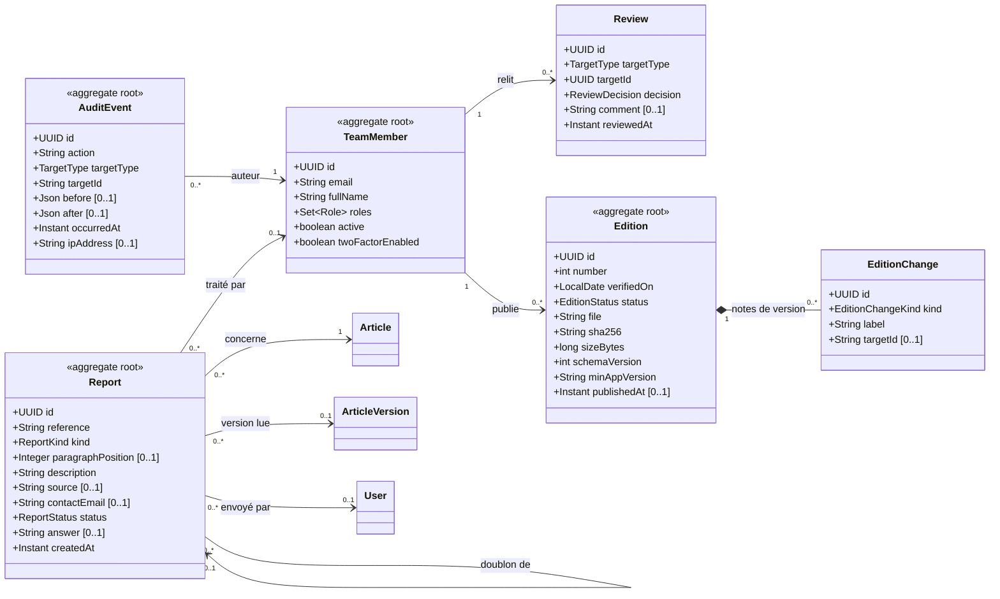
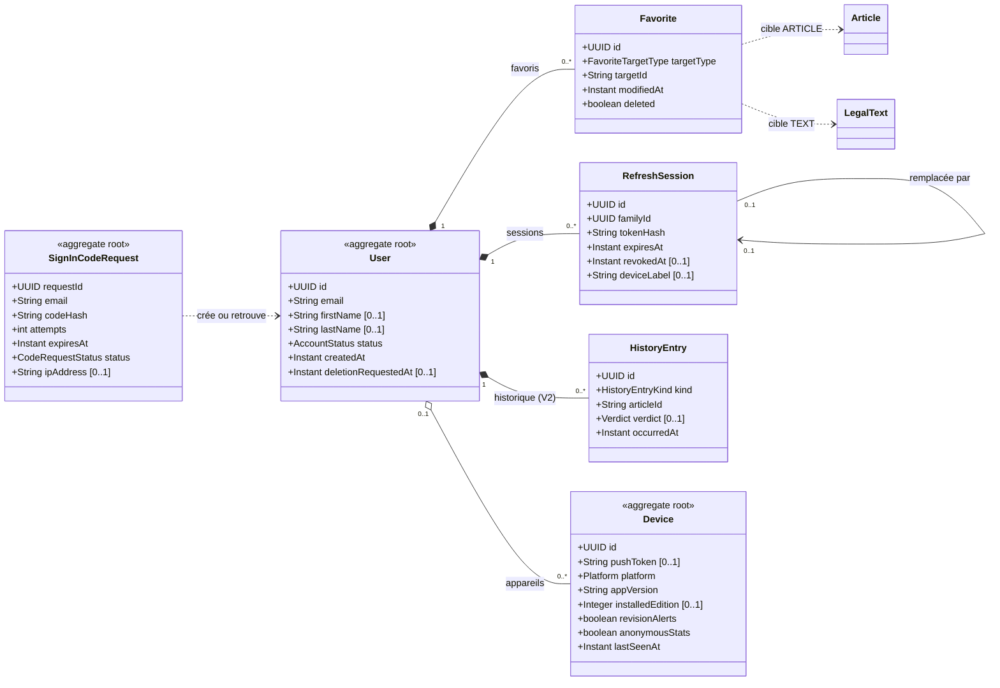
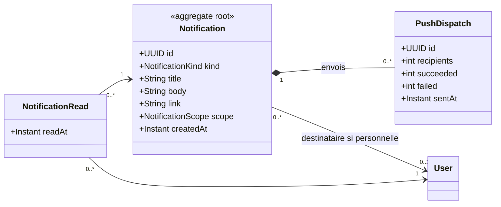
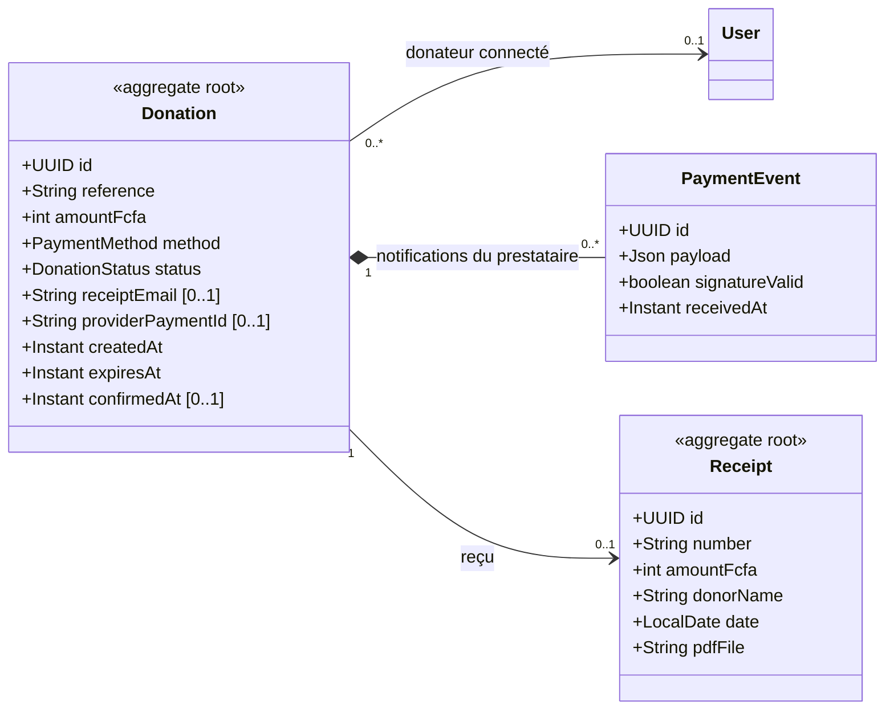

# 05 · Modèle du domaine

Le domaine est découpé en **cinq modules**. Chacun est un paquet Java du backend (`sn.sunudroit.<module>`, voir [08](08-architecture.md)).
Un module ne lit pas directement les tables d'un autre : il passe par sa partie publique.

| Module (code) | Nom métier | Rôle | Version |
|---|---|---|---|
| **corpus** | corpus | Le droit lui-même : textes, structure, articles, versions, révisions, renvois, notes | V1 |
| **editorial** | atelier | Le travail de l'équipe : relecture, éditions publiées, signalements, audit | V1 |
| **account** | compte | Utilisateurs, codes de connexion, sessions, favoris, historique, appareils | V1 |
| **notification** | notification | Boîte de notifications et envois push | V1 (push d'édition), V2 (boîte) |
| **donation** | don | Dons, paiements, reçus | V2 |

Ce document décrit les **concepts métier**. Les tables SQL précises sont dans [06](06-modele-donnees.md).

**Langue des noms** : les classes, attributs et valeurs d'énumération portent **les noms du code, en anglais** (DEC-16).
Les explications restent en français. Les mêmes diagrammes existent au format Excalidraw dans [`excalidraw/`](excalidraw/) ;
les deux sont produits à partir d'une seule description, ils ne peuvent pas diverger.

### Correspondance des termes

| Français (métier) | Code (anglais) | Français (métier) | Code (anglais) |
|---|---|---|---|
| Texte | `LegalText` | Membre de l'équipe | `TeamMember` |
| Division (titre, chapitre, intertitre) | `Division` | Relecture | `Review` |
| Intitulé versionné d'une division | `DivisionVersion` | Édition du corpus | `Edition` |
| Article | `Article` | Note de version | `EditionChange` |
| Version d'article | `ArticleVersion` | Événement d'audit | `AuditEvent` |
| Alinéa | `Paragraph` | Signalement | `Report` |
| Segment (morceau d'alinéa) | `Segment` | Utilisateur | `User` |
| Révision (acte modificatif, acte d'origine) | `Amendment` | Demande de code | `SignInCodeRequest` |
| Effet d'une révision | `AmendmentEffect` | Session de rafraîchissement | `RefreshSession` |
| Note éditoriale | `EditorialNote` | Favori, historique, appareil | `Favorite`, `HistoryEntry`, `Device` |
| Renvoi | `CrossReference` | Don, notification de paiement, reçu | `Donation`, `PaymentEvent`, `Receipt` |
| Référence au Journal officiel | `journalNumber`, `journalDate`, `journalPage` | Notification, lecture, envoi push | `Notification`, `NotificationRead`, `PushDispatch` |

**Conventions des diagrammes** : `[0..1]` = attribut facultatif (`@Nullable` dans le code) ;
`«aggregate root»` = racine d'agrégat, avec son propre repository ; une racine en désigne une autre **par identifiant**
(`legalTextId`, `amendmentId`…), jamais par une référence d'objet.

---

## Module corpus

Le droit est un **graphe** de textes reliés, pas une liste de PDF.
Le modèle a été vérifié sur la Constitution : version compilée par le Conseil constitutionnel (à jour de la loi
constitutionnelle n° 2018-14) et version du Secrétariat général du Gouvernement (sec.gouv.sn, 2019).

| Cas réel dans la Constitution | Concept qui le gère |
|---|---|
| Préambule sans numéro, « partie intégrante » | `Division` de kind `PREAMBLE` contenant un `Article` de kind `PREAMBLE` |
| Pas de chapitres ni de sections, mais des « sous-titres » (« MARIAGE ET FAMILLE », « TRAVAIL ») qui contiennent des articles | `Division` de kind `HEADING`, enfant d'un `TITLE`. `CHAPTER` et `SECTION` restent pour les lois organiques |
| « TITRE PREMIER », « TITRE VI BIS », « TITRE VII-1 » | `Division.label` (libellé officiel) + `Division.position` (ordre) |
| Titre VII-1 ajouté par la loi 2003-15 ; Titre VI BIS ajouté « après l'article 66 » par la loi 2016-10 | Une division **naît** avec sa première `DivisionVersion`, qui cite sa révision source |
| Titre II renommé en 2016, Titre VI en 2012, Titre VII-1 en 2012 | `DivisionVersion` (intitulé versionné) |
| Titre XIII « Dispositions transitoires » : ses articles 104 à 108 abrogés en 2016, le titre reste | Article abrogé conservé (`ArticleVersion.repealed`, RG-10) ; une division peut ne plus rien contenir en vigueur |
| « Article premier », articles 25-1, 66-1, 87-1 | `Article.number` (libellé officiel) + `Article.sortKey` (ordre) |
| Identifiants déjà utilisés par l'app : `const-art-92` | `Article.id` = `LegalText.articleIdPrefix` + `-art-` + numéro, calculé une fois (RG-01) |
| Référendum du 7 janvier 2001, puis loi n° 2001-03 du 22 janvier 2001 publiée au JORS | `LegalText.adoptionDate` = date d'adoption ; l'`Amendment` `ORIGINAL_ACT` porte la loi, sa date et sa référence au JO |
| Lois de révision citées sous chaque article | `Amendment`, rattaché à son texte (`legalTextId`) |
| « article modifiant les articles 7, 63, 68, 71 et 82 » | Un `AmendmentEffect` **par article visé** |
| « alinéa inséré par la loi 2008-30 », « dernier alinéa abrogé », « substituant les mots “Assemblée nationale” au mot “Parlement” » | `Paragraph.changedByAmendmentId` + `Paragraph.changeKind` ; l'opération dans `AmendmentEffect` |
| NB : « rédaction malencontreuse », « et les sénateurs subsiste », « modification annoncée non mise en œuvre » | `EditorialNote`, rattachée à une version et, si besoin, à un alinéa (`paragraphPosition`) |
| Article 102 : mots présents dans le texte promulgué mais absents de l'édition du JO | On reproduit le JO (RG-83) ; `EditorialNote` de kind `OMITTED_IN_JOURNAL` |
| Énumérations du préambule (« AFFIRME : – … ») et des articles 6 et 8 | `Paragraph` de kind `LIST_ITEM` |
| Révision de 2026 adoptée puis censurée | `Amendment.legalStatus = STRUCK_DOWN`, aucune version produite (RG-09) |

```mermaid
classDiagram
    direction LR

    class LegalText {
        <<aggregate root>>
        +String id
        +LegalTextType type
        +String officialTitle
        +String shortTitle
        +String subject [0..1]
        +LocalDate adoptionDate
        +String articleIdPrefix
        +String journalNumber [0..1]
        +LocalDate journalDate [0..1]
        +Integer journalPage [0..1]
        +LegalTextStatus status
    }

    class CrossReference {
        <<aggregate root>>
        +UUID id
        +CrossReferenceKind kind
        +String label [0..1]
        +String sourceArticleId
        +String targetLegalTextId
        +UUID targetDivisionId [0..1]
        +String targetArticleId [0..1]
    }

    class Division {
        +UUID id
        +DivisionKind kind
        +String label [0..1]
        +BigDecimal position
    }

    class Article {
        <<aggregate root>>
        +String id
        +String legalTextId
        +UUID divisionId
        +ArticleKind kind
        +String number [0..1]
        +String sortKey
    }

    class DivisionVersion {
        +UUID id
        +String heading [0..1]
        +LocalDate validFrom
        +LocalDate validTo [0..1]
        +boolean dateUncertain
        +boolean repealed
        +UUID amendmentId
        +EditorialStatus editorialStatus
    }

    class ArticleVersion {
        +UUID id
        +LocalDate validFrom
        +LocalDate validTo [0..1]
        +boolean dateUncertain
        +ArticleChangeKind changeKind
        +boolean repealed
        +UUID amendmentId
        +EditorialStatus editorialStatus
    }

    class EditorialNote {
        +UUID id
        +EditorialNoteKind kind
        +String content
        +String source [0..1]
        +Integer paragraphPosition [0..1]
    }

    class AmendmentEffect {
        +UUID id
        +String provision
        +EffectOperation operation
        +String officialWording
        +boolean applied
    }

    class Amendment {
        <<aggregate root>>
        +UUID id
        +String legalTextId
        +AmendmentKind kind
        +String number [0..1]
        +LocalDate actDate [0..1]
        +String title
        +String journalNumber [0..1]
        +LocalDate journalDate [0..1]
        +Integer journalPage [0..1]
        +AmendmentLegalStatus legalStatus
        +AmendmentIntegrationStatus integrationStatus
        +canChangeTheLaw() boolean
    }

    class Paragraph {
        +UUID id
        +int position
        +ParagraphKind kind
        +String content
        +List~Segment~ segments
        +UUID changedByAmendmentId [0..1]
        +ParagraphChangeKind changeKind [0..1]
    }

    class Segment {
        <<value>>
        +SegmentKind kind
        +String value
        +UUID crossReferenceId [0..1]
    }

    LegalText "1" *-- "1..*" Division : structure
    Division "0..1" o-- "0..*" Division : sous-divisions
    Division "1" *-- "1..*" DivisionVersion : intitulés dans le temps
    Article "0..*" --> "1" LegalText : appartient à (par id)
    Article "0..*" --> "1" Division : rangé dans (par id)
    Article "1" *-- "1..*" ArticleVersion : versions
    ArticleVersion "1" *-- "1..*" Paragraph : alinéas
    ArticleVersion "1" *-- "0..*" EditorialNote : notes
    Paragraph "1" *-- "1..*" Segment : segments
    Segment ..> CrossReference : lien cliquable
    CrossReference "0..*" --> "1" Article : depuis
    CrossReference "0..*" --> "1" LegalText : vers
    ArticleVersion "0..*" --> "1" Amendment : issue de (par id)
    DivisionVersion "0..*" --> "1" Amendment : issue de (par id)
    Paragraph "0..*" --> "0..1" Amendment : dernier changement
    Amendment "1" *-- "0..*" AmendmentEffect : effets
    Amendment "0..*" --> "1" LegalText : modifie (par id)
    AmendmentEffect "0..*" --> "0..1" Division : cible
    AmendmentEffect "0..*" --> "0..1" Article : cible
    AmendmentEffect "0..1" --> "0..1" ArticleVersion : produit
```

**Points de modélisation importants**

- **Trois racines d'agrégat principales** : `LegalText` (avec l'arbre de ses `Division` et leurs intitulés), `Article`
  (avec ses versions, alinéas et notes) et `Amendment` (avec ses effets). `CrossReference` est une quatrième racine.
  Chacune a son repository ; elles se désignent par identifiant.
- **Identifiants permanents** : `LegalText.id` (`constitution-2001`, `lo-2016-23`) et `Article.id` (`const-art-25-1`)
  sont des chaînes stables, écrites une fois, jamais réutilisées. Les favoris, les liens partagés et l'historique pointent vers eux (RG-01).
- **Une version est un instantané complet** de l'article. On ne stocke pas de différences : elles sont calculées à l'affichage (DEC-13).
  `Paragraph.changedByAmendmentId` dit seulement quel alinéa a bougé, pour l'afficher comme le fait le texte officiel.
- **« En vigueur » et « ancienne » ne sont pas stockés** : ils se déduisent des dates (`validTo` vide = en vigueur à ce jour).
- **L'acte d'origine est une révision comme une autre** : la loi n° 2001-03 est un `Amendment` de kind `ORIGINAL_ACT`,
  un seul par texte. Ainsi toute version a une révision source, sans cas particulier.
- **Une révision censurée ou en projet** existe dans le registre mais ne produit aucune version (RG-09,
  `Amendment.canChangeTheLaw()`). Un effet annoncé mais non mis en œuvre (article 84 en 2012) a `applied = false`,
  et une note `AMENDMENT_NOT_APPLIED` l'explique.
- **On ne corrige jamais le texte officiel** (RG-07), comme le Conseil constitutionnel. Les anomalies sont classées
  selon la typologie de sa note explicative (`EditorialNoteKind`).
- **Le rattachement d'un article à sa division** suit la structure actuelle. Si une révision déplace un article, on
  versionnera ce rattachement (cas non rencontré à ce jour, noté en Q-12).

### Énumérations du module corpus

| Énumération | Valeurs |
|---|---|
| `LegalTextType` | `CONSTITUTION`, `ORGANIC_LAW`, `DECISION` (V2) |
| `LegalTextStatus` | `IN_FORCE`, `REPEALED`, `STRUCK_DOWN` |
| `DivisionKind` | `PREAMBLE`, `TITLE`, `CHAPTER`, `SECTION`, `HEADING` (sous-titre ou intertitre) |
| `ArticleKind` | `ARTICLE`, `PREAMBLE` |
| `ArticleChangeKind` | `ORIGINAL`, `REPLACED`, `AMENDED`, `INSERTED`, `REPEALED` |
| `ParagraphKind` | `TEXT`, `LIST_ITEM` |
| `ParagraphChangeKind` | `INSERTED`, `REWRITTEN`, `WORDS_CHANGED` |
| `SegmentKind` | `TEXT`, `REFERENCE` |
| `AmendmentKind` | `ORIGINAL_ACT`, `CONSTITUTIONAL_LAW`, `REFERENDUM`, `ORGANIC_LAW` |
| `AmendmentLegalStatus` | `PROMULGATED`, `STRUCK_DOWN`, `DRAFT` |
| `AmendmentIntegrationStatus` | `TO_INTEGRATE`, `IN_PROGRESS`, `INTEGRATED` |
| `EffectOperation` | `REPLACES_ARTICLE`, `ADDS_ARTICLE`, `REPEALS_ARTICLE`, `INSERTS_PARAGRAPH`, `REWRITES_PARAGRAPH`, `REPEALS_PARAGRAPH`, `DELETES_WORDS`, `REPLACES_WORDS`, `ADDS_DIVISION`, `RENAMES_DIVISION` |
| `EditorialNoteKind` | `SPELLING_OR_GRAMMAR`, `SURVIVING_WORDS`, `DRAFTING_ERROR`, `BROKEN_REFERENCE`, `OMITTED_IN_JOURNAL`, `MISPLACED_PROVISION` (les six catégories de la note explicative du Conseil constitutionnel), `AMENDMENT_NOT_APPLIED`, `CLARIFICATION` |
| `CrossReferenceKind` | `SPECIFIED_BY` (un article renvoie à une loi organique), `CITED_BY` (une décision cite l'article, V2), `REFERS_TO` (renvoi interne : « article 63 ») |
| `EditorialStatus` | `DRAFT`, `IN_REVIEW`, `APPROVED`, `PUBLISHED`, `ABANDONED` : voir le cycle de vie dans [07](07-cycles-de-vie.md) |

---

## Module editorial (atelier)

| Énumération | Valeurs |
|---|---|
| `Role` | `EDITOR`, `REVIEWER`, `ADMIN` |
| `ReviewDecision` | `APPROVED`, `SENT_BACK` |
| `TargetType` | `ARTICLE_VERSION`, `DIVISION_VERSION`, `CROSS_REFERENCE`, `EDITORIAL_NOTE`, `AMENDMENT`, `EDITION`, `REPORT`, `TEAM_MEMBER` |
| `EditionStatus` | `IN_PREPARATION`, `PUBLISHED`, `WITHDRAWN` |
| `EditionChangeKind` | `NEW_VERSION`, `WORDING_VERIFIED`, `STRUCTURE_ADDED`, `NEW_TEXT`, `NOTE_ADDED`, `REFERENCE_ADDED` (libellés visibles sur E34) |
| `ReportKind` | `DIFFERS_FROM_JOURNAL`, `TYPO`, `WRONG_REFERENCE`, `MISSING_VERSION`, `OTHER` |
| `ReportStatus` | `NEW`, `UNDER_REVIEW`, `ACCEPTED`, `FIXED`, `REJECTED`, `DUPLICATE` : voir [07](07-cycles-de-vie.md) |

**La relecture concerne toute saisie** : version d'article, intitulé de division, renvoi, note. Le relecteur
ne peut pas être l'auteur de la saisie (RG-21). Chaque action de l'équipe produit un `AuditEvent` immuable (RG-24).

---

## Module account (compte)

| Énumération | Valeurs |
|---|---|
| `AccountStatus` | `ACTIVE`, `DELETION_REQUESTED` |
| `CodeRequestStatus` | `ISSUED`, `VERIFIED`, `EXPIRED`, `BLOCKED` |
| `FavoriteTargetType` | `ARTICLE`, `TEXT` (valeurs du contrat d'API, [09](09-api.md)) |
| `HistoryEntryKind` | `READING`, `VERIFICATION` |
| `Verdict` | `MATCHES`, `INACCURATE`, `NOT_FOUND` |
| `Platform` | `IOS`, `ANDROID` |

- **Un compte est identifié par son `id`, jamais par son e-mail** : l'adresse peut changer (RG-44), et des connexions
  Google ou Apple pourront s'ajouter plus tard dans une classe `ExternalIdentity` sans toucher aux comptes existants (DEC-17).
- **Un appareil existe sans compte** : il reçoit les notifications d'édition même pour un visiteur.
  À la connexion, il est rattaché à l'utilisateur ; à la déconnexion, détaché.
- **Les favoris ne sont jamais effacés physiquement pendant la synchronisation** : `deleted = true` avec la date,
  pour que la suppression se propage aux autres téléphones (RG-51).

---

## Module notification

| Énumération | Valeurs |
|---|---|
| `NotificationKind` | `CORPUS_UPDATED`, `FAVORITE_CHANGED`, `RECEIPT_AVAILABLE`, `REPORT_ANSWERED`, `NEWS` (types visibles sur E25) |
| `NotificationScope` | `EVERYONE` (édition, nouveauté) ou `PERSONAL` (reçu, favori modifié, réponse) |

---

## Module donation (don, V2)

| Énumération | Valeurs |
|---|---|
| `PaymentMethod` | `WAVE`, `ORANGE_MONEY` |
| `DonationStatus` | `INITIATED`, `PENDING`, `CONFIRMED`, `FAILED`, `EXPIRED`, `CANCELLED` : voir [07](07-cycles-de-vie.md) |

Le `Receipt` copie le nom et le montant au moment du don : il reste valable même si le compte est supprimé (RG-45, RG-64).

---

## Côté application mobile

L'app ne connaît pas tout le domaine. Elle manipule :

| Donnée | Où | Synchronisée |
|---|---|---|
| Édition du corpus (textes, versions, renvois, notes, index de recherche) | Fichier SQLite en lecture seule | Remplacée à chaque nouvelle édition |
| Favoris | SQLite locale | Oui, avec un compte |
| Historique (lectures, vérifications, citations) | SQLite locale | Non en V1 ; verdicts seulement en V2, jamais la citation |
| Signalements et changements en attente d'envoi | File d'envoi locale | Envoyés au retour du réseau |
| Préférences (thème, taille du texte, langue, statistiques) | Stockage clé-valeur | Non (RG-47) |
| Session (jetons) | Stockage chiffré (Keychain, Keystore) | |
