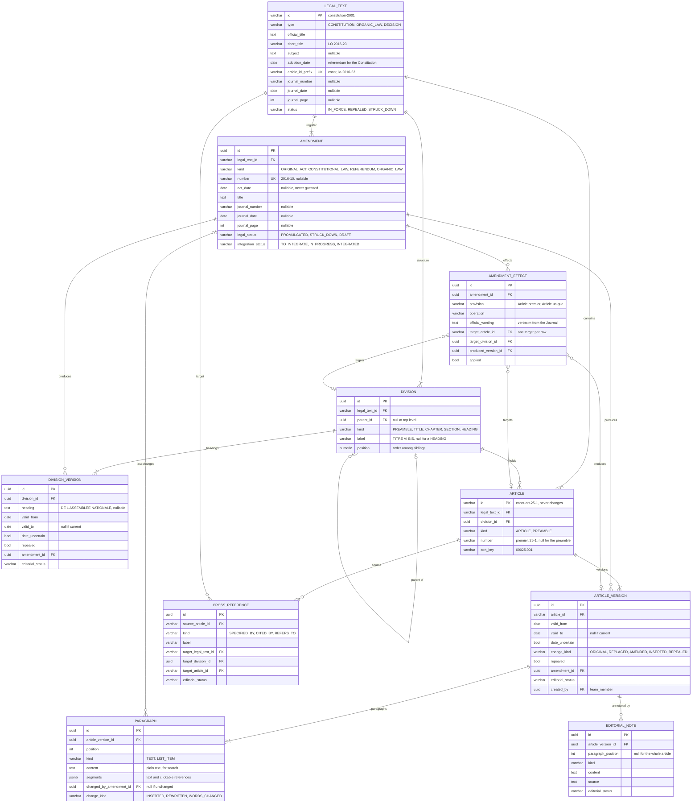
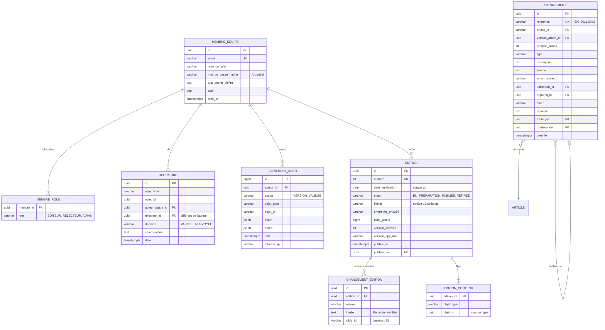
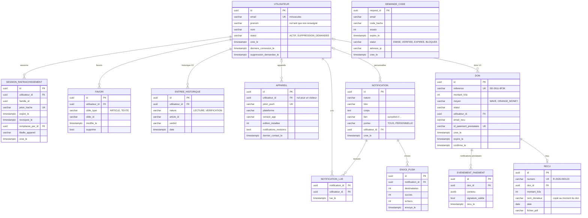
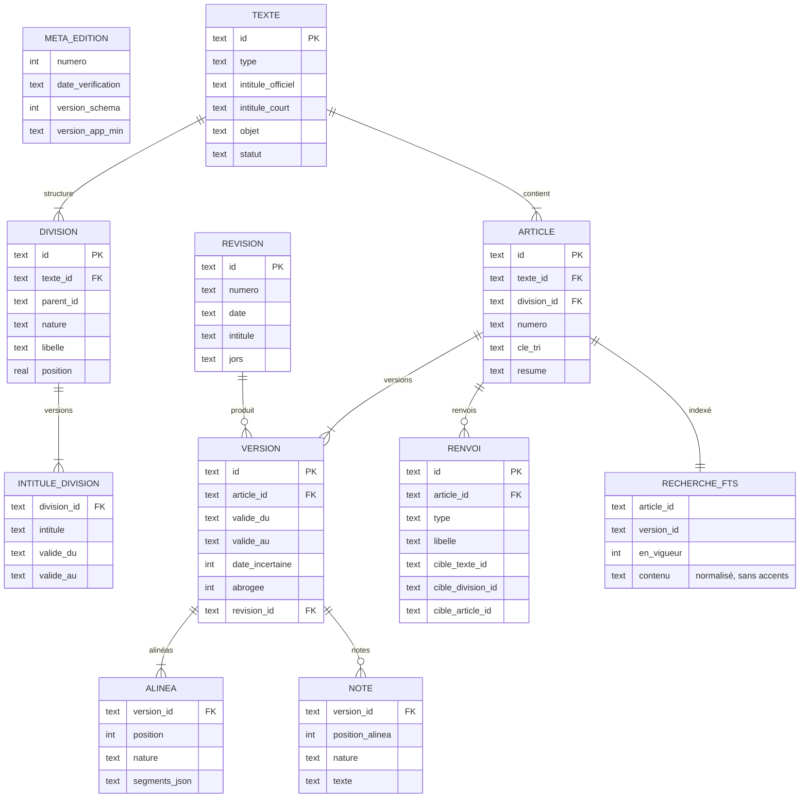
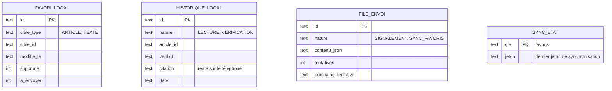

# 06 · Modèle de données

Deux bases, deux rôles :

| Base | Où | Rôle |
|---|---|---|
| **PostgreSQL** | Serveur (cloud européen) | Source de vérité : tout le corpus avec ses brouillons et son historique éditorial, les comptes, les dons |
| **SQLite** | Téléphone | (1) l'**édition** du corpus, en lecture seule, remplacée à chaque publication ; (2) une petite base **personnelle** (favoris, historique, file d'envoi) |

Conventions SQL : noms en `snake_case` sans accents, clés primaires `id`, dates en `timestamptz` (UTC),
dates juridiques en `date`, énumérations en `varchar` avec contrainte `CHECK`. Les migrations sont gérées par Flyway (DEC-12).
Noms des tables et colonnes **en anglais**, comme le code (DEC-18). Les sections ci-dessous autres que le corpus gardent
encore les noms français de la première modélisation : elles seront traduites quand chaque module sera développé,
en suivant la table de correspondance de [05](05-modele-domaine.md).

---

## PostgreSQL · Corpus

Tables et colonnes **en anglais**, comme le code (DEC-18). Les tables `legal_text` (V2, V3) et `amendment` (V4)
sont déjà créées par les migrations du backend ; les autres le seront dans cet ordre : `division`, `article`,
`article_version` et `paragraph`, puis `amendment_effect`, `editorial_note` et `cross_reference`.

Toutes les tables ont aussi `created_at`, `updated_at` (`timestamptz`) et `version` (`bigint`, verrouillage optimiste) ;
elles ne sont pas répétées dans le diagramme.

### Contraintes et index du corpus

| Contrainte | Implémentation PostgreSQL | Règle |
|---|---|---|
| Identifiant de texte lisible | `CHECK (id ~ '^[a-z0-9]+(-[a-z0-9]+)*$')` (migration V2) | RG-01 |
| Un seul acte d'origine par texte | Index unique partiel sur `amendment (legal_text_id) WHERE kind = 'ORIGINAL_ACT'` (migration V4) | RG-05 |
| Numéro de révision unique | `UNIQUE (number)` ; plusieurs révisions sans numéro restent possibles | |
| Pas de chevauchement de versions validées d'un même article | `EXCLUDE USING gist (article_id WITH =, daterange(valid_from, valid_to) WITH &&) WHERE (editorial_status IN ('APPROVED', 'PUBLISHED'))` (extension `btree_gist`) | RG-04 |
| Une seule version en vigueur par article | Index unique partiel sur `article_id` où `valid_to IS NULL AND editorial_status IN ('APPROVED', 'PUBLISHED')` | RG-04 |
| Même règle pour les intitulés de division | Mêmes contraintes sur `division_version (division_id, …)` | RG-11 |
| Identifiant d'article jamais réutilisé | Pas de suppression physique d'un article ; `id` immuable | RG-01 |
| Numéro unique dans un texte | `UNIQUE (legal_text_id, number)` | RG-02 |
| Préfixe d'article unique | `UNIQUE (article_id_prefix)` sur `legal_text` | RG-01 |
| Révision non promulguée sans effet | Vérifié par le use case (`Amendment.canChangeTheLaw()`) : aucune `article_version` ne référence une révision `STRUCK_DOWN` ou `DRAFT` | RG-09 |
| Ordre des articles | Index sur `(legal_text_id, sort_key)` | RG-02 |
| Recherche plein texte côté back-office | Colonne générée `tsvector` sur `paragraph.content` avec la configuration `french` + `unaccent`, index GIN | |

**Identifiant d'article** : `article.id` = `legal_text.article_id_prefix` + `-art-` + numéro en chiffres, calculé **une fois**
à la création (`const-art-1` pour l'article premier, comme l'app l'utilise déjà ; `const-art-25-1`), jamais recalculé
même si l'article est renuméroté (RG-01).

**Clé de tri** (`sort_key`) : numéro principal sur 5 chiffres, suffixe sur 3 : `premier` → `00001.000`,
`25` → `00025.000`, `25-1` → `00025.001`, `66-1` → `00066.001`. Le libellé officiel reste dans `number`.

**Les versions validées et publiées** comptent toutes deux pour les contraintes de période : une version publiée
garde ses dates, elle ne sort pas de la règle de non-chevauchement.

---

## PostgreSQL · Atelier

- `EDITION_CONTENU` fige la liste exacte des versions publiées dans chaque édition : on peut toujours répondre
  « que lisait un utilisateur de l'édition 12 ? » (RG-22).
- `EVENEMENT_AUDIT` n'accepte que des insertions (droit `INSERT` seul pour le rôle applicatif) (RG-24).

---

## PostgreSQL · Compte, notification, don

| Contrainte | Règle |
|---|---|
| `UNIQUE (utilisateur_id, cible_type, cible_id)` sur `favori` | RG-50 |
| `code_hache` : HMAC-SHA256 du code avec un secret serveur ; jamais le code en clair | RG-41 |
| `jeton_hache` : SHA-256 du jeton de rafraîchissement ; le jeton n'est connu que du téléphone | RG-42 |
| `UNIQUE (id_paiement_prestataire)` sur `don` : une notification de paiement rejouée ne crée pas de doublon | RG-61 |
| `montant_fcfa` entre 200 et 1 000 000 | RG-60 |

---

## SQLite · Édition du corpus (téléphone)

Un fichier par édition, généré par le serveur, **en lecture seule** sur le téléphone.
Il ne contient que les contenus **validés** : aucun brouillon, aucune donnée de l'équipe.

- `RECHERCHE_FTS` est une table virtuelle **FTS5** : recherche rapide et hors ligne, y compris dans les anciennes
  versions (filtre « Version : toutes » de E09). La tolérance aux fautes reste faite par `searchEngine.ts`.
- Taille estimée : quelques centaines de kilo-octets pour la Constitution et une loi organique, compressé en gzip.
- `version_schema` : si l'app ne connaît pas ce schéma, elle garde l'édition précédente et propose E39 (RG-27).

## SQLite · Données personnelles (téléphone)

Base séparée du corpus : elle survit au remplacement des éditions.

Les préférences (thème, taille du texte, langue, statistiques) restent dans le stockage clé-valeur déjà utilisé
(`expo-sqlite/kv-store`), la session dans `expo-secure-store` (RG-47).

---

## Dictionnaire des données (champs sensibles ou délicats)

| Champ | Signification exacte | Exemple | Piège à éviter |
|---|---|---|---|
| `article.id` | Identifiant permanent, construit une fois à la création | `const-art-25-1` | Ne jamais le recalculer depuis le numéro après une renumérotation |
| `article.numero` | Libellé officiel du numéro | `premier`, `25-1` | Ne pas convertir « premier » en « 1 » à l'affichage d'un texte officiel |
| `version_article.valide_du` | Date d'entrée en vigueur de cette rédaction | `2016-04-05` | Ce n'est pas toujours la date de la loi : vérifier la promulgation et la publication |
| `version_article.date_incertaine` | Vrai si la date n'est pas établie par une source | | Ne jamais inventer une date pour combler un trou (RG-08) |
| `version_article.valide_au` | Fin de validité, exclue | `2016-04-05` | Égale au `valide_du` de la version suivante |
| `alinea.segments` | Tableau ordonné `{nature: TEXTE, valeur}` ou `{nature: RENVOI, valeur, renvoiId}` | | La concaténation des valeurs doit égaler `texte_brut` |
| `revision.numero` | Numéro officiel de l'acte | `2016-10` | L'acte d'origine (`2001-03`) est aussi une révision |
| `effet_revision.formulation_officielle` | Phrase telle qu'au Journal officiel | « article supprimant les mots “et les sénateurs” » | Ne pas reformuler |
| `edition.date_verification` | Date à laquelle l'équipe a vérifié le corpus | `2026-11-21` | Affichée « Corpus du 21.11.2026 » (E01, E26, E28) |
| `don.statut` | Statut reçu du prestataire | | Ne jamais le modifier à partir d'une information venant de l'app (RG-61) |
