# 07 · Cycles de vie

Chaque diagramme décrit les états possibles d'un objet et ce qui le fait changer d'état.
Une transition absente du diagramme est **interdite** : le backend doit la refuser.

---

## 1. Saisie éditoriale (version d'article, intitulé de division, renvoi, note)

Champ : `statut_editorial`. Règles : RG-20, RG-21, RG-22, RG-25.

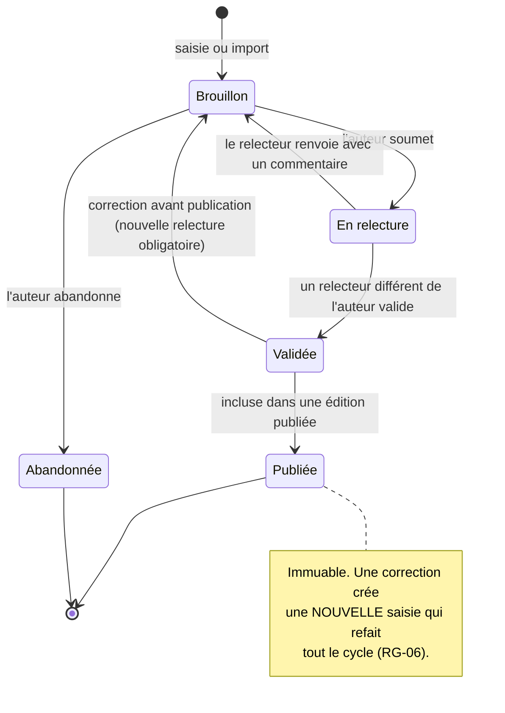

---

## 2. Révision (registre)

Deux dimensions indépendantes : le **statut juridique** (ce que dit le droit) et le **statut d'intégration** (où en est l'équipe).

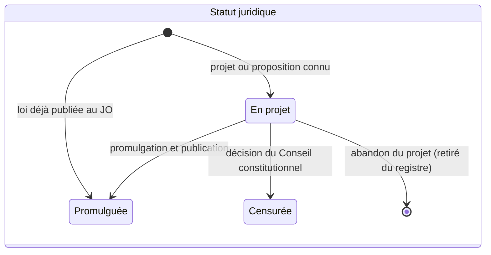

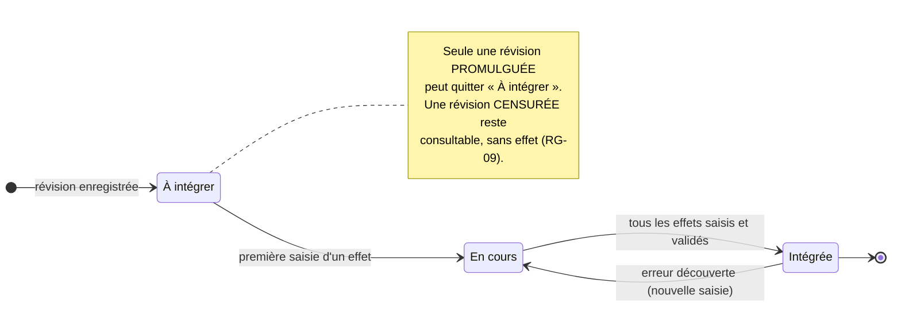

---

## 3. Version d'article (statut affiché à l'utilisateur)

Ce statut n'est **pas stocké** : il se déduit des dates et du champ `abrogee` au moment de l'affichage.

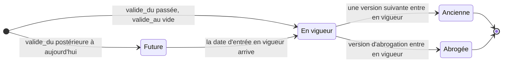

| Statut | Badge (E10, E11) | Couleur |
|---|---|---|
| En vigueur | « ● EN VIGUEUR » | Vert |
| Ancienne | « ANCIENNE » | Gris |
| Abrogée | « ABROGÉ » | Corail |
| Future | « EN VIGUEUR LE … » | Jaune |

---

## 4. Édition du corpus (serveur)

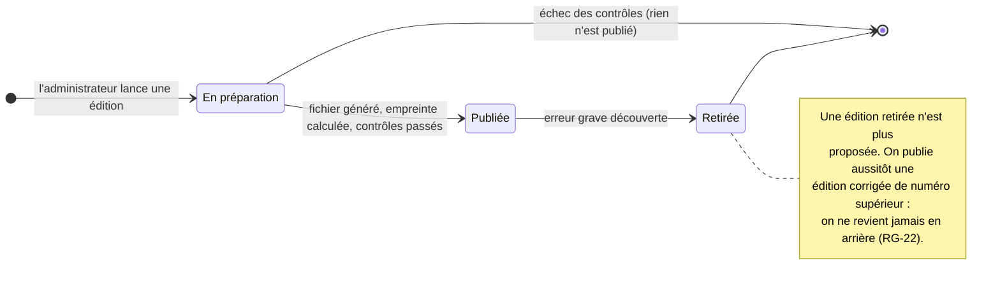

**Contrôles avant publication** : aucune version validée ne se chevauche ; tous les renvois pointent vers des textes présents ;
toutes les révisions citées existent ; chaque article a une version en vigueur ou abrogée ; le fichier s'ouvre et l'index de
recherche répond.

---

## 5. Mise à jour de l'édition (téléphone)

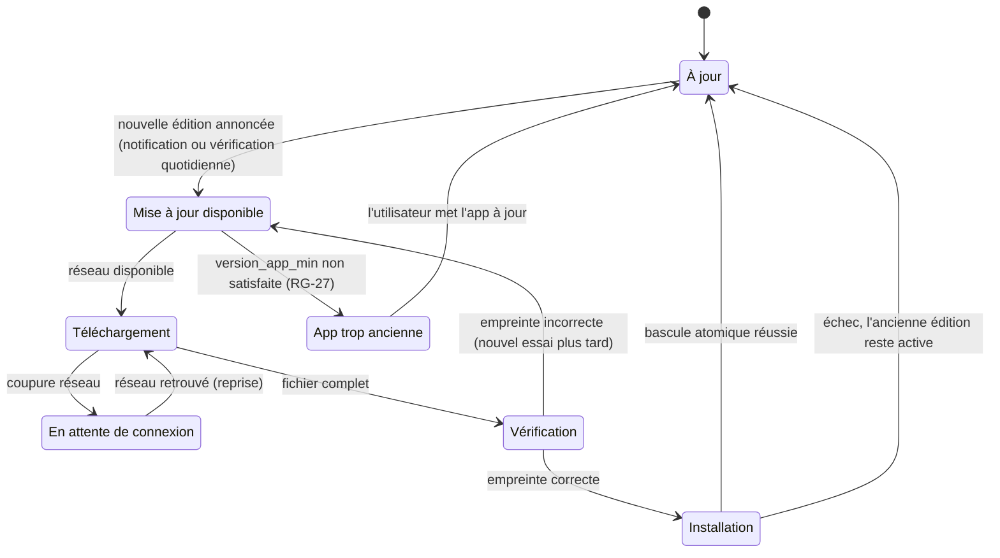

L'écran E34 montre les états « Disponible », « Téléchargement » (64 %) et « En attente de connexion ».

---

## 6. Demande de code de connexion

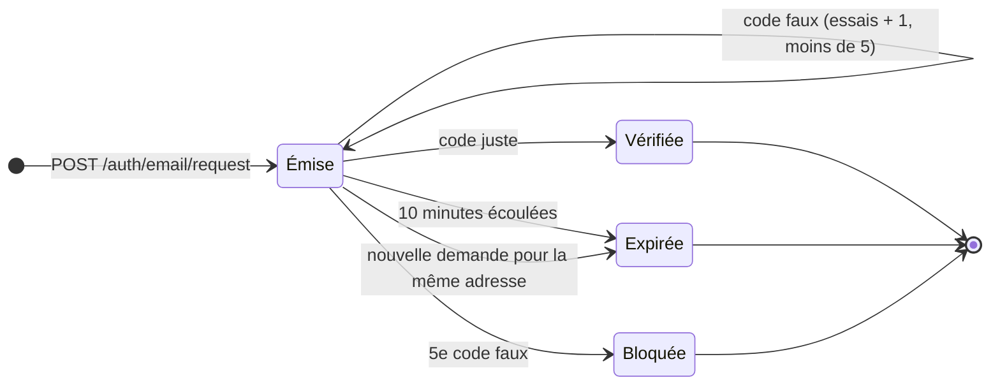

---

## 7. Session dans l'application

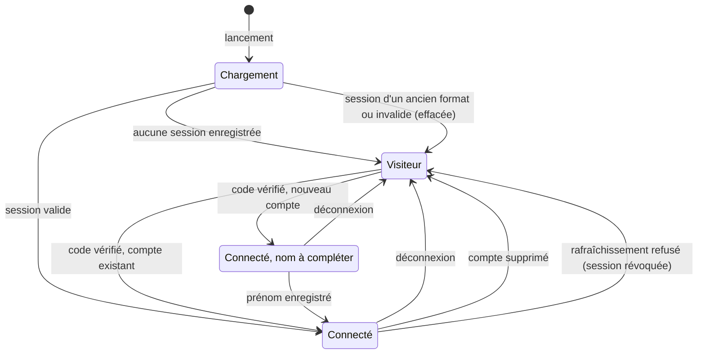

En cas de rafraîchissement impossible **faute de réseau**, l'utilisateur reste « Connecté » : il garde ses favoris locaux,
la synchronisation reprendra plus tard.

---

## 8. Signalement

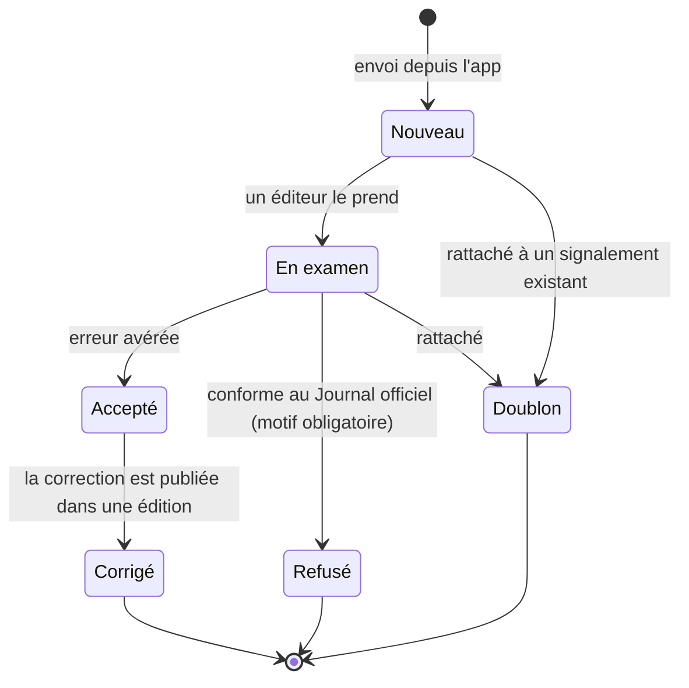

L'auteur, s'il a laissé un contact, reçoit un e-mail à l'entrée dans « Refusé » et dans « Corrigé » (RG-33).

---

## 9. Don (V2)

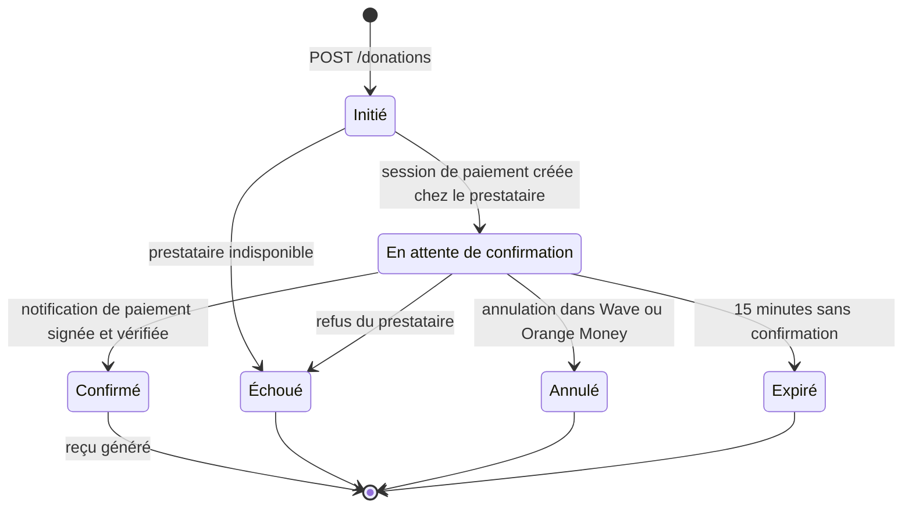

Les états finaux « Échoué », « Annulé » et « Expiré » s'affichent sur E19 avec « non débité » et la référence.
Seul le prestataire fait passer un don à « Confirmé » (RG-61).

---

## 10. Compte utilisateur

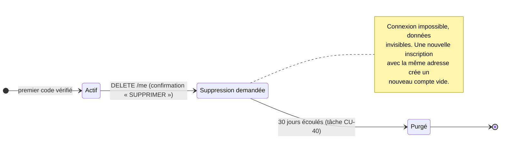
