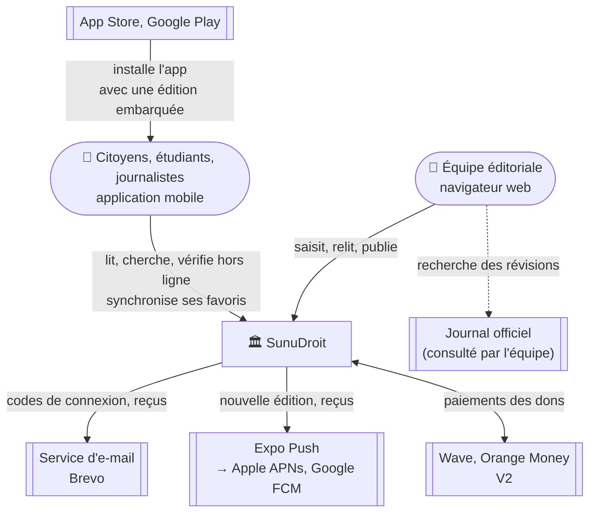
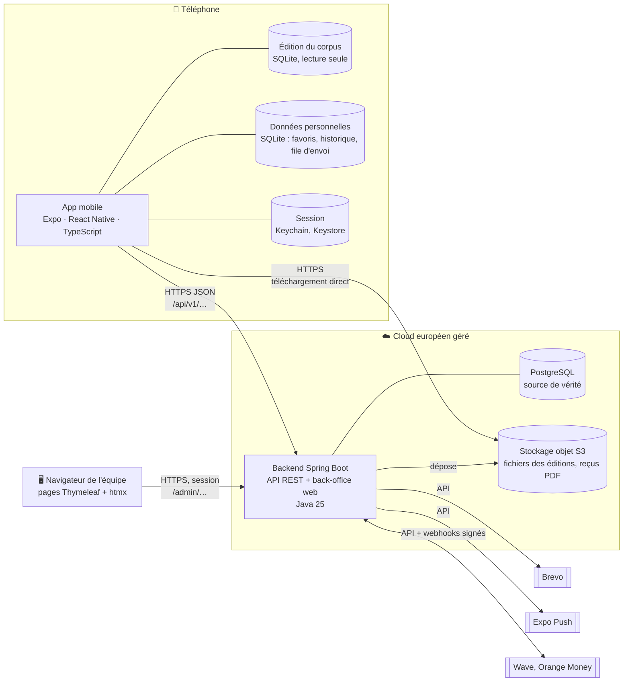
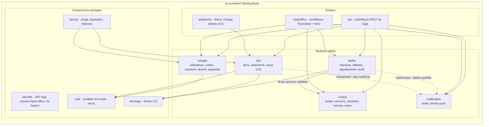
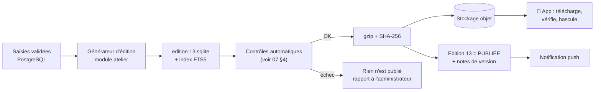
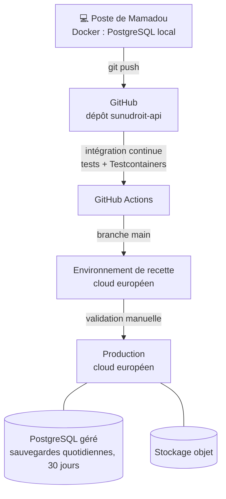

# 08 · Architecture

Présentée en trois niveaux de zoom, inspirés du modèle C4 : le **contexte** (le système et son entourage),
les **conteneurs** (les applications et bases), les **composants** (les modules du backend).

---

## Niveau 1 · Contexte



---

## Niveau 2 · Conteneurs



| Conteneur | Technologie | Responsabilité | Ne fait pas |
|---|---|---|---|
| App mobile | Expo SDK 58, Expo Router, Reanimated, SQLite | Toute la lecture, la recherche, la vérification, hors ligne ; compte ; envoi des signalements | Pas de logique éditoriale ; ne modifie jamais le corpus |
| Backend Spring Boot | Java 25, Spring Boot 4, Spring Security, Spring Data JPA, Flyway, Thymeleaf, htmx | API de l'app, back-office, génération des éditions, envois d'e-mails et de notifications | Pas de rendu des textes pour l'app (elle les a déjà) |
| PostgreSQL | PostgreSQL géré (version stable récente) | Données de référence, brouillons, comptes, audit | |
| Stockage objet | S3 compatible (Scaleway, Clever Cloud Cellar…) | Sert les fichiers d'édition et les reçus, avec un CDN si besoin | |

> Les versions exactes (Java, Spring Boot, PostgreSQL) seront confirmées au démarrage du backend : on prendra les dernières versions **stables à support long**.

---

## Niveau 3 · Modules du backend

Un **monolithe modulaire** : une seule application à déployer, découpée en modules aux frontières claires (DEC-02).
Spring Modulith permet de vérifier automatiquement qu'aucun module n'utilise l'intérieur d'un autre.



**Organisation d'un module** (exemple `corpus`, DEC-20) : d'abord par sujet, puis par couche.

```
sn.sunudroit.corpus
├── package-info.java           ← le module ; sa racine est la seule partie visible des autres modules
├── legaltext/                  ← un sujet
│   ├── domain/                 ← LegalText (entité JPA + règles), enums, LegalTextRepository, exceptions
│   ├── application/            ← command/ et usecase/ (un use case par action), port/ si système extérieur
│   └── api/                    ← LegalTextController, requêtes, réponses, gestion des erreurs
├── amendment/                  ← même découpage
└── article/                    ← même découpage (à venir)
```

Spring Modulith vérifie ces frontières dans un test (`ModularityTests`) : un module qui utilise une classe interne
d'un autre fait échouer ce test.

Les modules communiquent par **appel de service** (lecture) ou par **événement** (« édition publiée », « don confirmé »),
ce qui évite les dépendances circulaires.

---

## La chaîne de publication hors ligne

Le cœur de l'architecture : l'app lit **son** fichier, le serveur ne fait que produire des fichiers.



- **Édition embarquée** : chaque version de l'app sur les stores contient la dernière édition au moment de sa construction.
  Une première installation fonctionne donc **sans réseau**.
- **Fichier complet compressé** en V1 (quelques centaines de Ko). Des mises à jour différentielles seront envisagées
  si le corpus grossit (codes, décisions).
- **Compatibilité** : chaque édition déclare `version_schema` et `version_app_min` (RG-27).

---

## Synchronisation des favoris

- Chaque favori porte `modifie_le` et `supprime` (suppression logique).
- L'app envoie ses changements depuis le dernier **jeton de synchronisation** ; le serveur fusionne élément par élément,
  le plus récent l'emporte, et renvoie l'état fusionné et un nouveau jeton (RG-51).
- Si l'horloge du téléphone est fausse, le serveur borne `modifie_le` à son heure de réception.

---

## Sécurité

| Sujet | Mesure | Règle |
|---|---|---|
| Transport | HTTPS partout (TLS 1.2 minimum), HSTS sur le back-office | |
| Connexion de l'app | Code à 6 chiffres par e-mail ; jeton d'accès JWT 15 min ; jeton de rafraîchissement 30 jours à rotation, détection de réutilisation | RG-41, RG-42 |
| Back-office | Comptes nominatifs, mot de passe Argon2id, 2e facteur (TOTP), session courte, protection CSRF, rôles | DEC-11 |
| Limites de débit | Par adresse e-mail et par IP sur les codes ; par appareil et IP sur les signalements | RG-41, RG-32 |
| Webhooks de paiement | Signature vérifiée, idempotence par identifiant de paiement | RG-61 |
| Intégrité des éditions | Empreinte SHA-256 vérifiée par l'app avant installation | RG-28 |
| Données personnelles | Minimisation, chiffrement au repos (fourni par l'hébergeur), sauvegardes chiffrées, purge à 30 jours | RG-45, RG-80 |
| Secrets | Variables d'environnement de l'hébergeur, jamais dans le dépôt | |
| Journalisation | Pas d'e-mail ni de code dans les journaux ; identifiants techniques seulement | RG-80 |

---

## Déploiement



| Environnement | Usage | Données |
|---|---|---|
| Local | Développement | Corpus 2018 de démonstration, faux serveur d'e-mail |
| Recette | Essais avec l'app en version de test | Copie anonymisée de la production |
| Production | Utilisateurs | Réelles |

**Observabilité** : Spring Boot Actuator (santé, métriques), journaux structurés, alerte si l'API est indisponible
(l'écran E35 « Erreur 503 » doit rester rare). Les textes restant lisibles hors ligne, une panne du serveur n'empêche
jamais la lecture.
